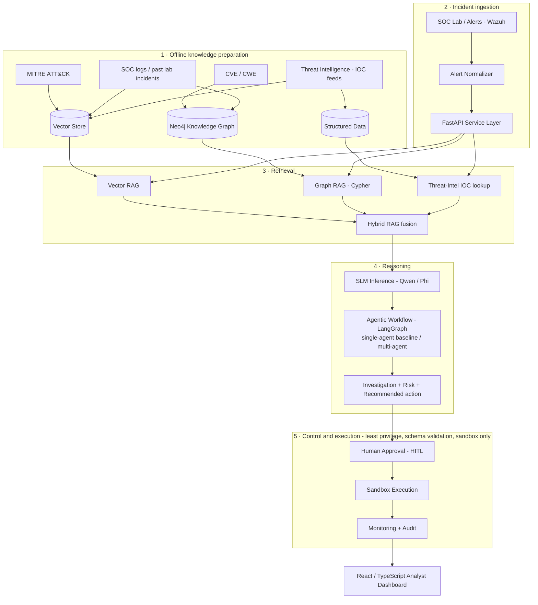
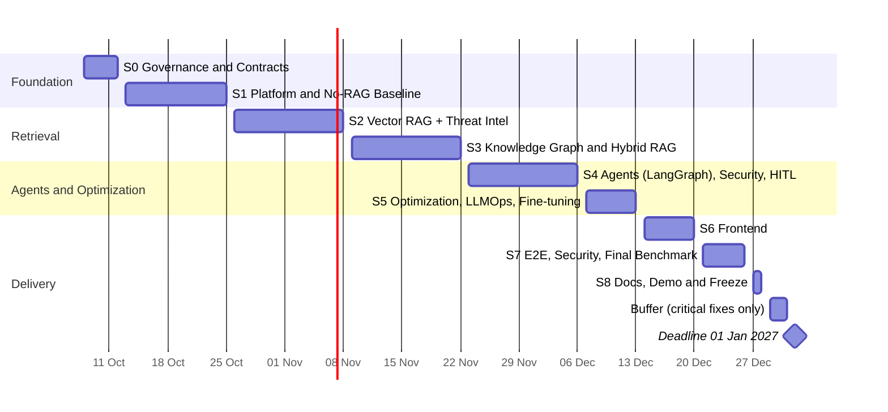
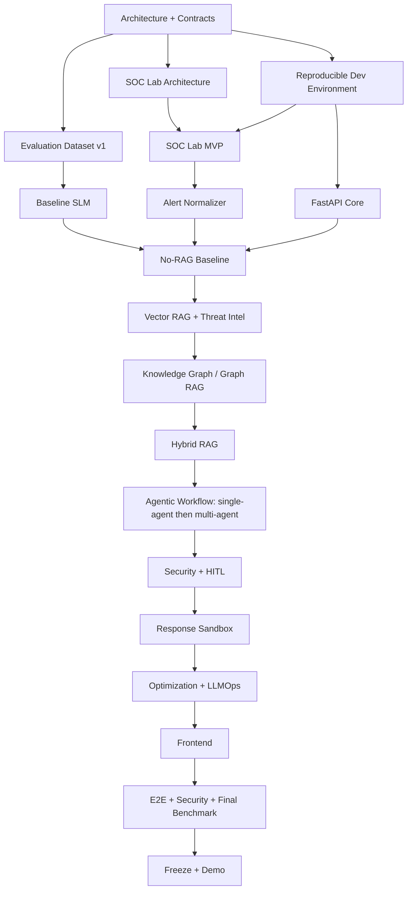

# CyberSOC AI — Cahier des Charges & Project Execution Plan

**Intelligent Cybersecurity SOC Assistant — Master Project 2026**

| | |
|---|---|
| **Version / status** | 2.2 — Team execution baseline, aligned with the project brief (supersedes v2.1) |
| **Date** | 10 October 2026 |
| **Team** | Ahmed · Soulaiman · Anas · Achraf · Oussama |
| **Deadline** | 01 January 2027 |
| **Working model** | Cross-functional, dependency-driven, iterative, DevSecOps + LLMOps |
| **Source of truth** | This file, `docs/CDC.md`. It defines scope, architecture, execution order, collaboration rules, dependencies, quality gates and final deliverables. Updated only through reviewed Pull Requests. |
| **Reference document** | Project brief *"Intelligent Cybersecurity SOC Assistant Using SLMs, Hybrid RAG, Agentic AI and LLMOps"* (traced in [Appendix A](#appendix-a--traceability-to-the-project-brief)) |

> **What changed in v2.2.** The v2.1 technical baseline and documentation workflow (one README per sprint, fixed member sections) are preserved. v2.2 closes the gaps found when the CDC was checked line by line against the six-page project brief: (1) the **Base vs Fine-tuned** experiment is now a required, time-boxed deliverable; (2) the **six-agent** multi-agent workflow is the target, three agents being only a reported fallback; (3) a written **evaluation methodology** (§9.8) defines faithfulness, response quality, SOC action correctness and security metrics; (4) **SOC logs** are now a retrieval source; (5) LLM security gains **quantitative metrics** (attack success rate before / after mitigation) and a jailbreak suite; (6) the **5-minute demo** now explains how the project was built and measured; (7) the overloaded inference task is split (S5-T02 / S5-T08); (8) new ADRs fix the model shortlist, the experiment-tracking tool and the supervisor-confirmed scope interpretations; (9) Appendix C was recomputed from the task tables and Appendix D (task registry) was added. See Appendix B, changes C13–C21.

---

## Contents

- [1. Purpose of this document](#1-purpose-of-this-document)
- [2. Project Overview](#2-project-overview)
- [3. Scope](#3-scope)
- [4. Architecture Principles](#4-architecture-principles)
- [5. Logical Architecture](#5-logical-architecture)
- [6. Core Contracts](#6-core-contracts)
- [7. SOC Lab & Validation Environment](#7-soc-lab--validation-environment)
- [8. Data, Models, Compute & Artifact Management](#8-data-models-compute--artifact-management)
- [9. Experimental Track](#9-experimental-track)
- [10. LLM Security Requirements](#10-llm-security-requirements)
- [11. DevSecOps + LLMOps Working Model](#11-devsecops--llmops-working-model)
  - [11.6 Sprint documentation & contribution traceability](#116-sprint-documentation--contribution-traceability)
- [12. Team Operating Model](#12-team-operating-model)
- [13. Definition of Ready](#13-definition-of-ready)
- [14. Definition of Done](#14-definition-of-done)
- [15. Priority & Domain Model](#15-priority--domain-model)
- [16. Dependency Types](#16-dependency-types)
- [17. Sprint Plan — Dependency-First Execution](#17-sprint-plan--dependency-first-execution)
  - [Sprint 0 — Governance, Architecture, Contracts & Planning](#sprint-0--governance-architecture-contracts--planning)
  - [Sprint 1 — Platform Baseline, SOC Lab MVP & No-RAG Baseline](#sprint-1--platform-baseline-soc-lab-mvp--no-rag-baseline)
  - [Sprint 2 — Vector RAG & Threat-Intelligence Ingestion](#sprint-2--vector-rag--threat-intelligence-ingestion)
  - [Sprint 3 — Knowledge Graph, Graph RAG & Hybrid RAG](#sprint-3--knowledge-graph-graph-rag--hybrid-rag)
  - [Sprint 4 — Agentic Workflow (LangGraph), LLM Security, HITL & Response Sandbox](#sprint-4--agentic-workflow-langgraph-llm-security-hitl--response-sandbox)
  - [Sprint 5 — Inference Optimization, LLMOps Maturity & Fine-Tuning](#sprint-5--inference-optimization-llmops-maturity--fine-tuning)
  - [Sprint 6 — Frontend / Analyst Experience](#sprint-6--frontend--analyst-experience)
  - [Sprint 7 — End-to-End Validation, Security Hardening & Final Benchmark](#sprint-7--end-to-end-validation-security-hardening--final-benchmark)
  - [Sprint 8 — Documentation, Demo & Feature Freeze](#sprint-8--documentation-demo--feature-freeze)
  - [Buffer — 29 Dec → 31 Dec 2026](#buffer--29-dec--31-dec-2026)
- [18. Critical Path](#18-critical-path)
- [19. Parallel-Safe Work Examples](#19-parallel-safe-work-examples)
- [20. Risk Register](#20-risk-register)
- [21. Issue Template](#21-issue-template)
- [22. Pull Request Template](#22-pull-request-template)
- [23. Architecture Decision Records](#23-architecture-decision-records)
- [24. Final Deliverables](#24-final-deliverables)
- [25. Final 5-Minute Demo Target](#25-final-5-minute-demo-target)
- [26. Project Success Criteria](#26-project-success-criteria)
- [27. Team Commitment](#27-team-commitment)
- [Appendix A — Traceability to the Project Brief](#appendix-a--traceability-to-the-project-brief)
- [Appendix B — Change Log (v1.0 → v2.2)](#appendix-b--change-log-v10--v22)
- [Appendix C — Ownership & Domain Exposure Matrix](#appendix-c--ownership--domain-exposure-matrix)
- [Appendix D — Task Registry](#appendix-d--task-registry)

---

## 1. Purpose of this document

This CDC is the shared reference for the CyberSOC AI project. It is kept in the GitHub repository as `docs/CDC.md` and updated only through reviewed changes. It implements the six-page project brief and defines:

- project objective and scope;
- target architecture;
- functional and non-functional requirements;
- SOC Lab strategy;
- data, model and compute management;
- DevSecOps and LLMOps workflow;
- team rotation model;
- dependency-first sprint plan;
- task acceptance criteria;
- final deliverables and freeze rules.

> **Main planning rule**
>
> Technical dependencies come before calendar convenience or artificial task rotation. Tasks that are truly independent may run in parallel. Integration tasks may start only when their required inputs are ready.

## 2. Project Overview

### 2.1 Project name

**CyberSOC AI — Intelligent Cybersecurity SOC Assistant**

### 2.2 Main objective

Design and implement an intelligent Security Operations Center assistant using:

- Small Language Models (SLMs), such as Qwen and Phi;
- Retrieval-Augmented Generation (RAG): vector retrieval, Knowledge Graph / Neo4j, Graph RAG and Hybrid RAG;
- Agentic AI: stateful single- and multi-agent workflows built with **LangGraph**;
- controlled response automation (human-approved, sandboxed);
- inference optimization: quantization, KV cache, FlashAttention, batching, prefix caching and optimized serving with vLLM;
- DevSecOps and LLMOps;
- a React / TypeScript analyst dashboard and a FastAPI backend.

The target analyst workflow is:

```mermaid
flowchart LR
    A[Alert / Incident] --> B[Detection / Triage] --> C[Evidence Collection]
    C --> D[Vector RAG + KG Investigation] --> E[Agentic Analysis]
    E --> F[Explanation + Risk Assessment] --> G[Recommended Action]
    G --> H{{Human Approval - HITL}} --> I[Controlled Sandbox Execution]
    I --> J[Monitoring + Audit]
    style H fill:#D97706,color:#fff
    style I fill:#D97706,color:#fff
```



### 2.3 Academic objective

The project must include a rigorous experimental study comparing, where feasible:

- Qwen vs Phi and/or other compact SLMs;
- Base vs lightweight QLoRA fine-tuned model (required, minimal and time-boxed — §9.3);
- No-RAG vs Vector-RAG vs Graph-RAG vs Hybrid-RAG;
- FP16 vs INT8 / INT4;
- without vs with KV cache;
- single-agent baseline vs multi-agent workflow.

### 2.4 Team-learning objective

The team deliberately avoids permanent silos. All five members must gain hands-on exposure to several of the following domains: SOC / cybersecurity, AI / SLM evaluation, RAG, Knowledge Graph / Neo4j, Agentic AI, backend, frontend, DevOps / CI/CD, LLMOps, LLM security, testing and documentation. **No critical subsystem should be understood by only one person.** [Appendix C](#appendix-c--ownership--domain-exposure-matrix) shows the resulting ownership matrix.

### 2.5 Mandatory constraints from the project brief

| Constraint | How the CDC satisfies it |
|---|---|
| Team of 5 students | §12 — Ahmed, Soulaiman, Anas, Achraf, Oussama |
| GitHub repository | §11 monorepo, branch and PR workflow; §24 deliverables |
| Full report in Markdown (README) | Root README is the consolidated final report; sprint READMEs are the execution journal (§11.5–§11.6); checkpoints S5-T07, S6-T07; finalization S8-T01 |
| Demo of 5 minutes maximum explaining all steps | §25 (method + product + results); S6-T07, S8-T05 |
| Deadline 01/01/2027 | §17 — feature freeze 28 Dec, buffer 29–31 Dec |

## 3. Scope

### 3.1 In scope

**SOC / cybersecurity**

- structured incident representation; SOC alert analysis; MITRE ATT&CK concepts; CVE / CWE information;
- threat-intelligence context (ingested from at least one real feed snapshot — S2-T08); risk assessment; recommended response actions;
- human-approved execution; complete auditability.

**AI / SLM**

- benchmark compact language models; cybersecurity-oriented prompting; structured outputs;
- hallucination / faithfulness evaluation;
- lightweight QLoRA fine-tuning of one SLM on the triage task (required, minimal, time-boxed), preceded by an error analysis that selects the target; hallucination / faithfulness and response-quality evaluation per §9.8; latency, throughput and memory benchmarking.

**Retrieval**

- No-RAG baseline; Vector RAG; Graph RAG; Hybrid RAG; retrieval evaluation;
- retrieval sources: MITRE ATT&CK, CVE / CWE, threat-intelligence IOCs **and SOC logs / historical lab incidents** (indexed as a separate vector collection and loaded into the graph).

**Knowledge Graph**

- Neo4j relationships between users, hosts, IP addresses, alerts, vulnerabilities, malware, threat indicators and MITRE ATT&CK techniques.

**Agentic AI**

- A stateful SOC investigation workflow implemented with **LangGraph**, delivered in two forms that are compared experimentally: a **single orchestrated agent** (baseline) and a **multi-agent workflow** with the six agents named in the brief: Triage, Investigation, RAG, Knowledge Graph, Threat Intelligence and Response. Six agents is the target; a reduced topology is only a documented, reported fallback (S4-T07).

**Controlled response**

- structured action proposals; schema validation; permission checks; human approval; sandbox execution; audit trail.

**Inference optimization**

- 4/8-bit quantization, KV cache, FlashAttention, batching, prefix caching and optimized serving (vLLM), measured on latency, throughput and memory.

**Web application**

- React / TypeScript dashboard and FastAPI backend; incident visualization; evidence and explanation display; graph exploration; risk / recommendation display; response approval; audit history.

**DevSecOps + LLMOps**

- Git-based collaboration; CI/CD; automated tests; code-quality and dependency/security checks; Docker / reproducible environments;
- model / prompt / dataset / retrieval / agent-trajectory versioning; experiment tracking; tracing and monitoring.

### 3.2 Out of scope for the initial prototype

Unless time and resources clearly permit, the project will not attempt:

- unrestricted response on real infrastructure; production SIEM replacement;
- enterprise-scale distributed GPU infrastructure; Kubernetes production deployment;
- training an LLM from scratch; internet-wide threat-intelligence crawling;
- fully autonomous incident response.

### 3.3 Detection boundary

The brief's workflow starts with "Alert → Detection". In CyberSOC AI, **detection is performed upstream** by the SOC platform (Wazuh rules and decoders running in the SOC Lab); building a new detection engine is out of scope. The project's contribution begins when an alert is normalized into the incident contract and covers **AI-assisted triage**: validating whether the alert is a true or false positive, assessing severity, mapping it to MITRE ATT&CK techniques and explaining the verdict. These triage decisions are labelled in the evaluation dataset (S1-T02) and scored with accuracy, precision, recall and F1 (§9.1). The final report must state this boundary explicitly. Because this is an interpretation of the brief, it is confirmed with the supervisor in Sprint 0 and recorded in ADR-009.

## 4. Architecture Principles

### 4.1 Dependency-first engineering

The project follows this high-level order:

```
Foundation + Contracts  →  SOC Lab MVP + Evaluation Data  →  Baseline SLM + FastAPI
→ Vector RAG (+ threat-intel ingestion)  →  Knowledge Graph  →  Graph RAG  →  Hybrid RAG
→ Agentic Workflow (single → multi-agent)  →  LLM Security + HITL + Sandbox
→ Inference Optimization + LLMOps Maturity  →  Frontend
→ End-to-End Validation + Final Benchmark  →  Documentation + Demo Freeze
```

### 4.2 Core-before-orchestration rule

Agents must orchestrate working components; they must not hide unfinished components. Before serious agent integration, the following must already work independently: SLM inference, Vector RAG, graph retrieval, Hybrid RAG, threat-intelligence lookup and backend service contracts. The single-agent baseline is built first; the multi-agent workflow extends it and reuses its tools, contracts and controls.

### 4.3 API-first / contract-first rule

Frontend implementation is intentionally late. During early and middle phases the system is validated through FastAPI OpenAPI documentation, automated tests, curl / HTTP clients and Python integration tests. The React application is implemented after the main backend response contracts are stable enough to avoid repeated rework.

### 4.4 Correctness-before-optimization rule

The order is: **correct baseline → measure → identify bottleneck → optimize → measure again**. Quantization, KV cache, FlashAttention, prefix caching, batching and optimized serving are therefore not part of the earliest implementation phases.

## 5. Logical Architecture



Retrieved content, threat-intelligence data and log content are treated as **untrusted input** at every stage (§10).

## 6. Core Contracts

Contracts are defined early so members can work independently without breaking one another's components. They may evolve, but **changes must be reviewed** because multiple components depend on them.

### 6.1 Incident contract

Minimum normalized incident structure:

```json
{
  "incident_id": "INC-001",
  "timestamp": "2026-10-08T12:00:00Z",
  "source": "wazuh",
  "description": "Multiple failed SSH logins",
  "severity": "high",
  "entities": [
    {"type": "ip", "value": "10.0.0.8"},
    {"type": "host", "value": "server-01"}
  ],
  "raw_event_ref": "optional-reference"
}
```

### 6.2 Retrieval contract

Conceptual input and output (the `source` field covers MITRE ATT&CK, CVE / CWE, threat intelligence and graph evidence):

```jsonc
// request
{
  "query": "...",
  "top_k": 5,
  "filters": {}
}

// response
{
  "evidence": [
    {
      "source": "MITRE ATT&CK",
      "content": "...",
      "score": 0.91
    }
  ]
}
```

### 6.3 Investigation result contract

```json
{
  "incident_id": "INC-001",
  "trace_id": "TRC-001",
  "summary": "...",
  "risk_level": "high",
  "evidence": [],
  "mitre_techniques": [],
  "recommended_actions": []
}
```

### 6.4 Response-action contract

```json
{
  "action_id": "ACT-001",
  "action_type": "block_ip",
  "target": "10.0.0.8",
  "reason": "Repeated malicious authentication attempts",
  "requires_approval": true,
  "status": "proposed"
}
```

### 6.5 Agent trace-record contract

Every agent run produces a versioned trajectory so that LLMOps can evaluate tool-call failures, trace complexity and decision paths, and so that the audit trail can reproduce a decision.

```json
{
  "trace_id": "TRC-001",
  "incident_id": "INC-001",
  "workflow": "single_agent | multi_agent",
  "versions": {"model": "...", "prompt": "...", "dataset": "soc-eval-v1", "commit": "<git-sha>"},
  "steps": [
    {"step": 1, "agent": "triage", "tool": "hybrid_rag", "input_ref": "...",
     "output_ref": "...", "status": "ok", "latency_ms": 412}
  ]
}
```

## 7. SOC Lab & Validation Environment

The SOC Lab is a **continuous workstream**, not one isolated sprint.

### 7.1 Purpose

- realistic logs and alerts; repeatable incident scenarios;
- validation data for RAG / KG / agents;
- a safe environment for approved response actions;
- final end-to-end demo scenarios.

### 7.2 Minimum viable SOC Lab

```
Attack / Simulation Source
        ↓
Linux Endpoint + Windows Endpoint (if resources allow)
        ↓
Wazuh / SOC Platform  →  Alerts / Logs  →  Normalizer  →  Incident Contract  →  CyberSOC AI
```

The project should avoid turning the lab itself into a second full-scale project.

### 7.3 Example lab scenarios

- SSH brute force; repeated login failure;
- suspicious PowerShell execution; suspicious process launch;
- privileged-account creation; malicious / suspicious outbound connection;
- test malware / hash scenario; file integrity change.

### 7.4 Response sandbox

Approved actions are executed only in isolated / simulated infrastructure, for example: block a test IP; disable a test account; stop a test process; apply a test firewall rule; quarantine a test file.

## 8. Data, Models, Compute & Artifact Management

### 8.1 Source of truth model

The team does not synchronize whole PCs. It synchronizes:

```
Code + Configurations + Dataset Versions + Model Versions + Experiment Results
```

### 8.2 Where things live

| Location | Store | Do not store |
|---|---|---|
| GitHub | Source code; configuration files; lightweight test fixtures; experiment definitions; documentation; Docker / CI files | Large model weights; giant raw log collections; secrets; large PCAPs; private / sensitive raw datasets |
| Shared artifact / model storage (service selected by ADR-006) | Fine-tuned adapters; larger evaluation datasets; threat-intel snapshots; generated benchmark outputs; model artifacts; large intermediate experiment artifacts | Secrets |
| Local computers | Git; Python / FastAPI; React; Docker; Neo4j; vector database; RAG development; tests; small-model inference; SOC Lab / VMs | — |
| Cloud GPU (Kaggle / Colab or equivalent) | LoRA / QLoRA fine-tuning; heavier SLM inference; quantization, vLLM and GPU-serving experiments; performance benchmarks | Authoritative project workspace — notebooks are compute only |

### 8.3 Official benchmark environment

All official performance comparisons must use **one standardized reference environment** whenever possible (frozen in S5-T01). Record at minimum:

- GPU / CPU type; RAM / VRAM; OS; Python version; PyTorch / runtime version (including vLLM and FlashAttention support);
- model version; dataset version; prompt version; retrieval configuration; Git commit SHA.

Do not compare model speed across different hardware and treat the result as a valid model comparison.

## 9. Experimental Track

### 9.1 SLM benchmark

Evaluate selected compact models (Qwen and Phi families, plus other compact SLMs where feasible) on triage verdict, severity and MITRE mapping using:

- accuracy, precision, recall, F1-score;
- hallucination / faithfulness;
- response quality (rubric-based) and SOC action correctness;
- latency, throughput, memory usage.

### 9.2 Retrieval benchmark

Compare 1) No-RAG, 2) Vector-RAG, 3) Graph-RAG, 4) Hybrid-RAG, using Recall@K, Precision@K, MRR, evidence relevance and answer faithfulness. Retrieval is evaluated **independently of generation** first (S2-T03), then end-to-end (S2-T06, S3-T07).

### 9.3 Fine-tuning benchmark

The brief requires a **Base vs Fine-tuned** comparison, so one minimal fine-tuning experiment is a required deliverable. It stays off the critical path of the platform (nothing else depends on its outcome) and is kept small and time-boxed so that it cannot threaten the schedule:

```
Base SLM  →  RAG-enabled baseline  →  Error analysis (S5-T05)  →  QLoRA fine-tuning, 1 model / 1 task / 1 adapter (S5-T06)  →  Base vs Fine-tuned on soc-eval-v1 test split
```

- **Scope:** one SLM, the triage task (verdict, severity, MITRE mapping), one QLoRA adapter, time-box of three working days, trained on cloud GPU.
- **Data hygiene:** training uses only the `soc-eval-v1` train split (S1-T02); the frozen test split is never seen during training or prompt tuning. Indexed SOC logs exclude test-split incidents (§9.8).
- **Evaluation:** official reference environment (S5-T01), same prompts and metrics as the base model.
- **Outcome rule:** the experiment is complete when the comparison is reported, **whether the adapter improves, degrades or leaves the results unchanged** — a negative result with analysis is valid; not running the experiment is not.

### 9.4 Inference benchmark

Inference optimization follows the correctness-before-optimization rule and runs in the frozen reference environment. The study covers every technique named in the brief:

| Technique | Comparison | Condition |
|---|---|---|
| Quantization | FP16 vs INT8 vs INT4 | Quality degradation measured on soc-eval-v1 (test split) |
| KV cache | Without vs with KV cache | Isolated ablation on a fixed prompt set |
| FlashAttention | Standard vs FlashAttention attention kernels | If supported by GPU and runtime; otherwise documented as unsupported, with evidence |
| Prefix caching | Without vs with prefix caching | Shared system / instruction prefixes across incidents |
| Batching | Single request vs batched requests | Throughput vs latency trade-off |
| Optimized serving | Baseline serving vs vLLM | Combines continuous batching, prefix caching and KV-cache management |

Metrics: **TTFT**, **tokens/second**, total latency, memory consumption and quality degradation.

### 9.5 Agent benchmark

Compare the **single orchestrated agent** (S4-T03) with the **multi-agent LangGraph workflow** (S4-T07) on the same incidents, model and retrieval configuration using task correctness, tool-call failures, response-action correctness, latency and trace complexity (from the trajectories of §6.5). Both variants are required deliverables; the comparison is executed in S4-T08 and repeated in the final benchmark (S7-T04).

### 9.6 Experiment discipline

Do not run a giant Cartesian product of every variable. Use **staged ablation**:

```
Select baseline SLM → Select retrieval strategy → Select agent architecture
→ Select inference optimization → Final integrated benchmark
```

### 9.7 Experiment map

| Experiment | Variable | Where |
|---|---|---|
| SLM comparison | Qwen vs Phi / other compact SLMs | S1-T03, S1-T07 |
| Retrieval | No-RAG vs Vector vs Graph vs Hybrid | S2-T06, S3-T07 |
| Fine-tuning | Base vs lightweight QLoRA fine-tuned (required, minimal) | S5-T05, S5-T06 |
| Inference | FP16/INT8/INT4 · KV cache · batching | S5-T02 |
| Serving stack | FlashAttention · prefix caching · baseline serving vs vLLM | S5-T08 |
| Agents | Single-agent vs multi-agent (six agents) | S4-T08 |
| LLM security | Mitigations off vs on: attack success rate, block rate, false-refusal rate | S4-T04, S7-T02 |
| Final integrated benchmark | Selected configuration (incl. fine-tuned vs base), frozen environment | S7-T04 |

### 9.8 Evaluation methodology and metric definitions

Metrics named in §9.1–§9.5 are only comparable if every task uses the same definitions. These are fixed in S0-T06 (conventions) and implemented in S1-T02 (dataset and protocol); they are not redefined later without a reviewed change.

| Metric | Definition / procedure |
|---|---|
| Triage accuracy, precision, recall, F1 | Verdict (true / false positive) against `soc-eval-v1` labels; positive class = true positive incident; macro-F1 reported for severity and MITRE technique |
| Faithfulness (hallucination rate) | Each answer is split into atomic claims; a claim is *supported* if the cited evidence entails it. Faithfulness = supported claims / total claims; hallucination rate = 1 − faithfulness. Judged by an LLM judge that is different from the evaluated model, with a rubric prompt and fixed temperature; judge reliability is validated against a manually labelled subset (target: at least 50 claims double-labelled by two members, agreement reported as Cohen's kappa) |
| Response quality | Rubric scored 1–5 on four criteria: correctness, evidence use, actionability, safety / appropriateness; same judge procedure and the same manual validation subset |
| SOC action correctness | Proposed action compared with the expected action(s) of the evaluation case: exact match on action type and target, plus the rate of actions rejected by schema or permission checks |
| Retrieval quality | Recall@K, Precision@K, MRR against evidence relevance judgements on the evaluation set (K = 5 by default) |
| Agent metrics | Task correctness, tool-call failure rate, response-action correctness, latency and trace complexity (steps / tool calls per incident, from §6.5 trajectories) |
| Inference metrics | TTFT, tokens/second, total latency, peak memory, quality degradation relative to FP16 |
| Security metrics | Attack success rate (ASR) per threat class with mitigations off and on, block / detection rate, false-refusal rate on a benign control set, number of secrets leaked (target 0) |

**Evaluation data hygiene.** `soc-eval-v1` has a *development* split (prompt design, error analysis, fine-tuning training data) and a frozen *test* split used only for reported results. Lab incidents or logs indexed into the vector store or graph exclude test-split incidents so that retrieval cannot leak the answer.

**Statistical hygiene.** Reported differences state the number of cases; where the sample is small (as expected for a lab-built dataset), results are described as indicative and limitations are written in the experiment record (§14).

## 10. LLM Security Requirements

The project must address the nine threat classes below, each with a mitigation, an implementing task and a verifying task.

| Threat | Mitigation | Build / Test |
|---|---|---|
| Prompt injection | Instruction / data separation; input screening; structured prompts | S4-T04 / S7-T02 |
| Indirect prompt injection | Logs, retrieved documents and threat-intel text treated as untrusted data | S4-T04 / S7-T02 |
| Jailbreaking | Fixed, versioned system prompts; role-play / instruction-override / multi-turn jailbreak suite; refusal tests; operational-constraint checks; system-prompt integrity test | S4-T04 / S7-T02 |
| Data leakage | Secret scanning; output filtering; no secrets in prompts or Git | S0-T04, S4-T04 / S7-T02 |
| RAG poisoning | Source provenance; ingestion validation; poisoned-document test cases | S2-T01, S2-T08 / S7-T02, S7-T03 |
| Insecure tool use | Tool allowlists; argument validation; least privilege | S4-T02, S4-T04 / S7-T02 |
| Excessive agency | Human approval for sensitive actions; no autonomous execution | S4-T05 / S7-T02 |
| Output validation | Schema validation of every model output and action | S4-T04 / S7-T01 |
| Auditability | Append-only log of prompts, context, decisions, tool calls and actions | S4-T05 / S7-T01 |

**Security evaluation protocol.** Security is *evaluated*, not only implemented:

- the abuse-case suite contains **at least five cases per threat class** (at least 45 in total), stored as versioned fixtures in `security/` and `datasets/evaluation/`;
- every case is run **with mitigations off and with mitigations on**; the results table reports attack success rate (ASR), block rate and false-refusal rate on a benign control set per threat class;
- a threat class is accepted when its ASR with mitigations on is reported, every residual failure has an Issue, and no critical case (secret leak, unapproved execution, out-of-allowlist tool call) succeeds;
- backend-level cases are built in S4-T04; UI-level cases and the full results table are completed in S7-T02.

**Security rules**

- retrieved content is untrusted input; secrets never go into Git;
- tool access follows least privilege; action outputs use validated schemas;
- security-sensitive actions require human approval; execution is sandboxed;
- critical actions are logged;
- the model never receives unrestricted infrastructure privileges.

## 11. DevSecOps + LLMOps Working Model

### 11.1 Monorepo

Recommended structure:

```
cybersoc-ai/
├── backend/
├── frontend/
├── ai/
├── rag/
├── knowledge-graph/
├── agents/
├── security/
├── datasets/
│   ├── samples/
│   ├── evaluation/
│   └── README.md
├── experiments/
├── infrastructure/
│   ├── soc-lab/
│   ├── response-sandbox/
│   └── docker/
├── tests/
├── docs/
│   ├── CDC.md
│   ├── architecture/
│   ├── adr/
│   └── sprints/
│       ├── sprint-00/README.md
│       ├── sprint-01/README.md
│       ├── sprint-02/README.md
│       ├── sprint-03/README.md
│       ├── sprint-04/README.md
│       ├── sprint-05/README.md
│       ├── sprint-06/README.md
│       ├── sprint-07/README.md
│       └── sprint-08/README.md
├── .github/
├── docker-compose.yml
├── .gitignore
└── README.md
```

### 11.2 Branch workflow

```
main
├── feature/<issue-number>-short-name
├── fix/<issue-number>-short-name
└── experiment/<issue-number>-short-name
```

### 11.3 Pull Request flow

```
Issue → Branch → Implementation → Tests → Pull Request → Peer Review → CI → Merge
```

### 11.4 LLMOps metadata

Every important experiment records: experiment ID; model / version; prompt / version; dataset / version; embedding model; chunking configuration; retrieval configuration; graph configuration; inference configuration (quantization, KV cache, FlashAttention, prefix caching, serving engine); **agent workflow and agent-trajectory trace ID**; metrics; evaluation protocol / judge version; timestamp; Git commit SHA. The experiment-tracking tool is selected in ADR-010 (Sprint 1).

### 11.5 Living-report rule

The root `README.md` is the **consolidated final project report** and must not be written from scratch in the last days. Detailed execution evidence is captured continuously in one dedicated README per sprint (§11.6). The root report is progressively consolidated from those sprint documents, architecture records, experiment results and accepted Pull Requests.

Two formal consolidation checkpoints are planned:

- **S5-T07** — consolidate the early report sections from Sprint 0–5 documentation: context, architecture, SOC Lab, data/compute strategy, baseline models, retrieval and Knowledge Graph results;
- **S6-T07** — consolidate agentic workflow, LLM security, inference optimization, LLMOps, frontend progress and the demo storyboard.

Sprint 8 therefore focuses on final synthesis, consistency review, figures, conclusions and submission quality rather than reconstructing project history.

### 11.6 Sprint documentation & contribution traceability

Each sprint has **exactly one dedicated `README.md`** under `docs/sprints/`. All sprint README files from Sprint 0 through Sprint 8 are created during Sprint 0 so the structure is fixed before implementation begins.

Required structure:

```text
docs/sprints/
├── sprint-00/README.md
├── sprint-01/README.md
├── sprint-02/README.md
├── sprint-03/README.md
├── sprint-04/README.md
├── sprint-05/README.md
├── sprint-06/README.md
├── sprint-07/README.md
└── sprint-08/README.md
```

Every sprint README is initialized with the same fixed sections:

```markdown
# Sprint X — <Title>

## Sprint Information
- Dates:
- Main objective:
- Main dependencies:
- Exit criteria:

## Sprint Tasks
| Task | Owner | Reviewer | Domain | Status |
|---|---|---|---|---|

# 1. Ahmed
## Assigned tasks
## Work completed
## Technical approach
## Files / components modified
## Tests / validation
## Results / metrics
## Problems encountered
## Decisions made
## Related Issues / Pull Requests
## Learning outcome

# 2. Soulaiman
<!-- same subsections -->

# 3. Anas
<!-- same subsections -->

# 4. Achraf
<!-- same subsections -->

# 5. Oussama
<!-- same subsections -->

# Shared Sprint Integration
## Integrated components
## Architecture changes
## Shared experiments
## Security considerations
## Known limitations
## Exit criteria verification
## Sprint retrospective
```

Documentation rules:

1. **Each member edits only their own named section** for individual task documentation unless a reviewed change explicitly requires otherwise.
2. Shared sections are updated by the sprint coordinator or by an explicitly assigned task to avoid competing edits.
3. Documentation is performed on the same feature/experiment branch as the related work whenever practical and is reviewed in the same Pull Request.
4. Each individual task entry references its GitHub Issue and related Pull Request(s).
5. Technical documentation must describe objective, approach, validation, results, problems/solutions and learning outcome; it must not be only a diary sentence such as “installed X and it worked.”
6. Screenshots are used only when they provide useful evidence; commands, configuration, metrics and reproducible steps are preferred.
7. A task cannot be marked **Done** until the relevant member section in the current sprint README is updated.
8. At sprint close, the common integration / retrospective sections are completed and the exit criteria are checked.

This model provides one clear document per sprint, preserves individual contribution traceability, supports the balanced-learning objective and reduces documentation ambiguity while keeping the final root README concise and consolidated.

## 12. Team Operating Model

### 12.1 Members

Ahmed · Soulaiman · Anas · Achraf · Oussama

### 12.2 No permanent technical roles

A member may lead one area in one sprint and move to another in the next.

### 12.3 Primary + reviewer rule

Each meaningful technical task has one primary implementer and one reviewer / shadow member. The reviewer should preferably have complementary or previous experience.

### 12.4 Knowledge continuity

When ownership rotates, the previous implementer should become reviewer / mentor when practical.

### 12.5 Dependency priority

Rotation never overrides a blocking technical dependency: **technical dependency > rotation preference**.

### 12.6 Shared team activities

All five participate in sprint planning, architecture decisions, demos, retrospectives, integration reviews, final report review and final presentation preparation.

## 13. Definition of Ready

A task is Ready only when:

- its objective is clear; acceptance criteria are written; required contracts are identified;
- blocking dependencies are complete or explicitly waived;
- required dataset / service access exists; secrets / access requirements are understood;
- implementer and reviewer are assigned.

An integration task is not Ready if one of its required upstream components does not yet have a stable interface.

## 14. Definition of Done

A technical task is Done only when all applicable conditions are satisfied:

- acceptance criteria met; code is on a dedicated branch; tests added / updated when relevant;
- local checks pass; CI passes; no secrets committed;
- Pull Request created; peer review completed; important comments resolved;
- the relevant member section in the current sprint README is updated, plus any shared/API/architecture documentation affected by the change; linked Issue closed;
- relevant experiment metadata stored.

An **experiment** is additionally Done only when the dataset / version, model / version, configuration, metrics and environment are recorded, conclusion and limitations are written, and the result is reproducible.

## 15. Priority & Domain Model

### 15.1 Priority

No effort tag is required.

| Tag | Meaning |
|---|---|
| P0 — Critical | Blocks project, demo or security |
| P1 — High | Required for the current sprint objective |
| P2 — Medium | Useful but movable |
| P3 — Low | Enhancement / nice-to-have |

### 15.2 Domain tags

`soc` · `ai-slm` · `rag` · `knowledge-graph` · `agents` · `backend` · `frontend` · `devops` · `llmops` · `llm-security` · `testing` · `documentation`

## 16. Dependency Types

Tasks use one of these labels in planning. Every Issue must include a Dependencies section.

| Type | Meaning |
|---|---|
| Blocking | Must finish before another task starts |
| Parallel-safe | Can run independently once shared contracts exist |
| Integration | Combines multiple completed components |
| Optional / Stretch | Can be dropped without breaking the MVP |

## 17. Sprint Plan — Dependency-First Execution

Dates are baseline planning dates and can move slightly, but the final feature freeze must remain before the deadline. “Rev.” denotes the reviewer.



### Sprint 0 — Governance, Architecture, Contracts & Planning

**Dates:** 08 Oct → 12 Oct 2026  
**Goal:** Remove ambiguity before implementation.

| Task | Owner · Reviewer | Type · Priority | Blocked by |
|---|---|---|---|
| **S0-T01 — GitHub governance and workflow**<br>• Repository workflow; Project statuses, priorities and domains<br>• Branch naming and Pull Request rules<br>• Issue template; Definition of Ready / Done | **Ahmed**<br>Rev. Soulaiman | Parallel-safe<br>P1 | — |
| **S0-T02 — Architecture and component boundaries**<br>• Component diagram and service boundaries<br>• Ownership-independent interfaces<br>• Critical path | **Soulaiman**<br>Rev. Anas | Parallel-safe<br>P0 | — |
| **S0-T03 — Incident, retrieval, response and trace contracts**<br>• Normalized incident schema; retrieval request/response schema<br>• Investigation result schema; response-action schema<br>• Agent trace-record schema (agent trajectories, §6.5) | **Oussama**<br>Rev. Ahmed | Blocking<br>P0 | S0-T02 |
| **S0-T04 — Security, secrets and HITL policy**<br>• Secret-handling and least-privilege rules<br>• Human-approval boundary; sandbox-only response rule | **Achraf**<br>Rev. Oussama | Blocking<br>P0 | S0-T02 |
| **S0-T05 — Data, knowledge-source and benchmark inventory**<br>• MITRE / CVE / CWE / threat-intel source inventory, incl. the threat-intel feed(s) that will actually be ingested (S2-T08)<br>• SOC-log sources: lab-generated logs and alerts to be indexed for retrieval (S2-T01)<br>• Candidate SOC datasets; evaluation-case requirements (incl. triage labels)<br>• Dataset licensing / usage notes<br>• **SLM shortlist** (Qwen-family and Phi-family models in a size range that fits the available GPUs, plus other compact candidates), with licence and memory fit; final choice recorded in ADR-002<br>*Note: v2.2 — adds SOC-log sources and the model shortlist.* | **Oussama**<br>Rev. Anas | Blocking<br>P1 | S0-T02 |
| **S0-T06 — Experiment and version-tracking convention**<br>• Experiment ID and model / prompt / dataset version conventions<br>• Benchmark result format; official benchmark environment template<br>• Agent-trajectory (trace) versioning convention<br>• **Metric definitions of §9.8** (faithfulness, response quality, action correctness, security metrics) and the dev / test split rule<br>• **Experiment-tracking tool selected (ADR-010)** among self-hostable or free options (e.g. MLflow, Langfuse, Weights & Biases free tier)<br>*Note: v2.2 — adds metric definitions and the tracking-tool decision.* | **Anas**<br>Rev. Ahmed | Blocking<br>P1 | S0-T05 |
| **S0-T07 — SOC Lab architecture and scenario plan**<br>• Minimum lab topology; required VMs / containers<br>• Initial attack / test scenarios; response-sandbox boundary | **Achraf**<br>Rev. Soulaiman | Blocking<br>P1 | S0-T02, S0-T04 |
| **S0-T08 — Initialize sprint documentation structure**<br>• Create `docs/sprints/sprint-00` through `sprint-08`<br>• Initialize one `README.md` per sprint with fixed sections for Ahmed, Soulaiman, Anas, Achraf and Oussama<br>• Add shared sprint integration, exit-criteria and retrospective sections<br>• Document editing / merge rules from §11.6 | **Ahmed**<br>Rev. Oussama | Parallel-safe<br>P1 | S0-T01 |

> **Exit criteria**
>
> - CDC accepted by all five members
> - Architecture and contracts reviewed
> - Security and lab boundaries understood
> - Project board ready
> - Sprint 0–8 README templates are initialized, committed and contain the five fixed member sections
> - Experiment versioning begins before the first benchmark
> - Supervisor has confirmed, or the team has recorded in ADR-009, the interpretation points: detection boundary (§3.3), six-agent target with reduced fallback (S4-T07), required minimal fine-tuning (§9.3)

### Sprint 1 — Platform Baseline, SOC Lab MVP & No-RAG Baseline

**Dates:** 13 Oct → 25 Oct 2026  
**Goal:** Produce the first reproducible, end-to-end baseline without RAG.

| Task | Owner · Reviewer | Type · Priority | Blocked by |
|---|---|---|---|
| **S1-T01 — Reproducible local environment + Docker + basic CI**<br>• Python / Node version conventions; Docker / Compose baseline<br>• .env.example; lint / test CI; setup documentation | **Ahmed**<br>Rev. Achraf | Blocking<br>P0 | S0-T01, S0-T04 |
| **S1-T02 — Evaluation dataset v1 and evaluation protocol**<br>• Fixed evaluation cases with expected labels: triage verdict (true / false positive), severity, MITRE technique, expected action<br>• Dataset version soc-eval-v1 with a **development split and a frozen test split** (§9.8)<br>• **Faithfulness protocol**: claim-level evidence check, judge prompt, and a manually double-labelled validation subset<br>• **Response-quality rubric** (four criteria, 1–5) and action-correctness matching rules<br>*Note: v2.2 — adds the evaluation protocol that gives hallucination / faithfulness and response quality an operational definition.* | **Anas**<br>Rev. Oussama | Blocking<br>P0 | S0-T03, S0-T05, S0-T06 |
| **S1-T03 — Baseline SLM runner**<br>• Model-loading abstraction; structured prompting<br>• First Qwen / Phi baseline runs; metrics stored with the S0-T06 convention | **Soulaiman**<br>Rev. Anas | Blocking<br>P0 | S1-T02 |
| **S1-T04 — FastAPI core + incident ingestion**<br>• Health endpoint; incident validation<br>• Baseline investigation endpoint; OpenAPI documentation | **Oussama**<br>Rev. Soulaiman | Blocking<br>P0 | S0-T03, S1-T01 |
| **S1-T05 — SOC Lab MVP**<br>• Minimal SOC / SIEM service with at least one endpoint<br>• One repeatable alert-generating scenario | **Achraf**<br>Rev. Ahmed | Blocking<br>P1 | S0-T07, S1-T01 |
| **S1-T06 — SOC alert normalizer**<br>• Raw lab alert → normalized incident contract<br>• Sample normalized fixtures; tests | **Ahmed**<br>Rev. Oussama | Blocking<br>P1 | S0-T03, S1-T05 |
| **S1-T07 — No-RAG end-to-end baseline**<br>• SOC Lab Alert → Normalizer → FastAPI → Baseline SLM → Structured Result | **Anas**<br>Rev. Ahmed | Integration<br>P0 | S1-T03, S1-T04, S1-T06 |

> **Exit criteria**
>
> - Project starts reproducibly
> - Lab generates at least one valid incident
> - Normalized incident reaches the backend
> - Baseline SLM produces a structured result
> - Baseline metrics are recorded
> - `soc-eval-v1` and its evaluation protocol (faithfulness, quality rubric, dev / test split) are versioned and reviewed

### Sprint 2 — Vector RAG & Threat-Intelligence Ingestion

**Dates:** 26 Oct → 08 Nov 2026  
**Goal:** Add evidence-grounded semantic retrieval, ingest real threat-intelligence data, and prove that retrieval quality is measurable.

| Task | Owner · Reviewer | Type · Priority | Blocked by |
|---|---|---|---|
| **S2-T01 — Cybersecurity knowledge normalization / ingestion**<br>• Normalized MITRE ATT&CK and CVE / CWE records; reproducible ingestion scripts<br>• **SOC-log corpus**: normalized lab alerts / log excerpts and historical lab incidents prepared for retrieval, excluding test-split evaluation incidents<br>• Source provenance recorded for every record (RAG-poisoning control)<br>*Note: v2.2 — adds SOC logs as a retrieval source (brief: MITRE, CVE/CWE, threat intelligence and SOC logs).* | **Ahmed**<br>Rev. Soulaiman | Blocking<br>P1 | S0-T05, S1-T06 |
| **S2-T02 — Chunking, embeddings and vector index**<br>• Chunking strategy, embedding model and vector index (config recorded)<br>• Separate collections for knowledge (MITRE, CVE / CWE) and for SOC logs / past incidents, with provenance metadata and filters | **Soulaiman**<br>Rev. Ahmed | Blocking<br>P0 | S2-T01 |
| **S2-T03 — Retriever evaluation**<br>• Retrieval evaluated independently before generation (Recall@K, Precision@K, MRR) | **Achraf**<br>Rev. Anas | Blocking<br>P1 | S1-T02, S2-T02 |
| **S2-T04 — Vector-RAG generation pipeline**<br>• Evidence-grounded generation with structured output and cited evidence | **Anas**<br>Rev. Oussama | Blocking<br>P0 | S1-T03, S2-T02, S2-T03 |
| **S2-T05 — RAG API integration**<br>• Vector-RAG exposed through the FastAPI investigation endpoint | **Oussama**<br>Rev. Anas | Integration<br>P0 | S1-T04, S2-T04 |
| **S2-T06 — No-RAG vs Vector-RAG experiment**<br>• First retrieval ablation with stored metrics and written conclusion | **Achraf**<br>Rev. Soulaiman | Integration<br>P1 | S2-T05 |
| **S2-T07 — SOC Lab scenario set v1**<br>• Multiple repeatable incidents for later regression | **Oussama**<br>Rev. Ahmed | Parallel-safe<br>P1 | S1-T05, S1-T06 |
| **S2-T08 — Threat-intelligence ingestion**<br>• At least one threat-intelligence source (offline snapshot / export of an IOC feed, licence permitting) normalized into IOC records: IP, domain, hash, malware family, tags, confidence<br>• IOC records loaded into the vector store and the structured store; IOC lookup function following the retrieval contract; fixtures and tests<br>• No internet-wide crawling: snapshots are versioned in artifact storage<br>*Note: Added in v2.0 — closes the Threat-Intelligence data gap.* | **Ahmed**<br>Rev. Oussama | Parallel-safe<br>P1 | S0-T05, S2-T01 |

> **Exit criteria**
>
> - Ingestion is reproducible (knowledge and threat intelligence)
> - Retriever quality is measured separately
> - Vector RAG works through the backend
> - No-RAG vs Vector-RAG results are recorded

### Sprint 3 — Knowledge Graph, Graph RAG & Hybrid RAG

**Dates:** 09 Nov → 22 Nov 2026  
**Goal:** Add structured cyber relationships and combine graph + vector evidence.

| Task | Owner · Reviewer | Type · Priority | Blocked by |
|---|---|---|---|
| **S3-T01 — Knowledge Graph ontology / schema**<br>• Node and relationship types: users, hosts, IPs, alerts, vulnerabilities, malware, ATT&CK techniques, threat indicators | **Ahmed**<br>Rev. Achraf | Blocking<br>P0 | S0-T03, S0-T05 |
| **S3-T02 — Graph ingestion / ETL**<br>• Reproducible ETL from knowledge sources, threat-intel IOCs and lab incidents into the graph model | **Soulaiman**<br>Rev. Ahmed | Blocking<br>P0 | S3-T01, S2-T08 |
| **S3-T03 — Neo4j population + Cypher validation**<br>• Populated Neo4j instance; validated Cypher queries | **Oussama**<br>Rev. Soulaiman | Blocking<br>P0 | S3-T02 |
| **S3-T04 — Graph retrieval service**<br>• Graph retrieval following the retrieval contract | **Anas**<br>Rev. Oussama | Blocking<br>P0 | S3-T03 |
| **S3-T05 — Graph-RAG pipeline**<br>• Graph-grounded generation pipeline | **Achraf**<br>Rev. Anas | Blocking<br>P0 | S1-T03, S3-T04 |
| **S3-T06 — Hybrid RAG orchestration**<br>• Vector + graph evidence fusion and ranking | **Anas**<br>Rev. Ahmed | Integration<br>P0 | S2-T04, S3-T05 |
| **S3-T07 — Retrieval comparison experiment**<br>• No-RAG vs Vector vs Graph vs Hybrid on the same dataset, same SLM, same environment | **Oussama**<br>Rev. Achraf | Integration<br>P1 | S3-T06 |

> **Exit criteria**
>
> - Graph schema documented
> - Graph populated reproducibly
> - Graph queries validated
> - Graph RAG and Hybrid RAG work
> - Comparison metrics are stored

### Sprint 4 — Agentic Workflow (LangGraph), LLM Security, HITL & Response Sandbox

**Dates:** 23 Nov → 06 Dec 2026  
**Goal:** Transform working primitives into a controlled SOC workflow, delivering both the single-agent baseline and the multi-agent workflow.

| Task | Owner · Reviewer | Type · Priority | Blocked by |
|---|---|---|---|
| **S4-T01 — Agent state model + structured agent contracts (LangGraph)**<br>• LangGraph state schema and typed node input / output contracts<br>• Agent trace-record implementation (§6.5); ADR-004 confirming LangGraph<br>*Note: LangGraph named explicitly in v2.0.* | **Soulaiman**<br>Rev. Achraf | Blocking<br>P0 | S0-T03, S3-T06 |
| **S4-T02 — RAG / KG / threat-intel tool adapters**<br>• Three tool adapters (Hybrid RAG, graph, threat-intel IOC lookup) with validated schemas and allowlists | **Ahmed**<br>Rev. Soulaiman | Blocking<br>P0 | S2-T05, S2-T08, S3-T04 |
| **S4-T03 — Single orchestrated investigation baseline**<br>• One LangGraph workflow with a single agent calling the three tools — the comparison baseline | **Anas**<br>Rev. Ahmed | Blocking<br>P0 | S4-T01, S4-T02 |
| **S4-T04 — Prompt-injection, jailbreak, tool-validation and output-validation controls**<br>• Untrusted-content handling; tool-argument and output schema validation<br>• First abuse-case suite (backend level) with **at least five cases per threat class** and a jailbreak suite (role-play, instruction override, multi-turn, system-prompt extraction)<br>• Results measured with mitigations off vs on (ASR, block rate, false-refusal rate on a benign control set, §10)<br>*Note: v2.2 — adds quantitative security metrics and jailbreak coverage.* | **Achraf**<br>Rev. Oussama | Blocking<br>P0 | S4-T01, S4-T02 |
| **S4-T05 — Human approval state + audit model**<br>• Approval state machine; append-only audit log of prompts, context, decisions, tool calls and actions | **Oussama**<br>Rev. Achraf | Blocking<br>P0 | S4-T01, S4-T04 |
| **S4-T06 — Response sandbox action execution**<br>• Approved actions executed only against isolated test targets | **Ahmed**<br>Rev. Oussama | Blocking<br>P0 | S0-T07, S4-T05 |
| **S4-T07 — Multi-agent LangGraph workflow**<br>• **Target: the six agents of the brief** — Triage, Investigation, RAG, Knowledge Graph, Threat Intelligence and Response — as LangGraph nodes / sub-graphs with supervisor routing<br>• Same contracts, validation, approval and audit controls as the single-agent baseline<br>• Fallback rule: if the sprint slips, the topology may be reduced (minimum: Triage, Investigation, Response; RAG, Knowledge Graph and Threat Intelligence calls then stay inside the Investigation agent). Any reduction must be declared in ADR-004, in the sprint README and in the final report as a deviation from the brief — and the single vs multi-agent comparison is never dropped<br>*Note: v2.2 — six agents are the target; three is a reported fallback only.* | **Soulaiman**<br>Rev. Anas | Integration<br>P1 · Required | S4-T03, S4-T04, S4-T05 |
| **S4-T08 — Agent / action correctness benchmark (single vs multi-agent)**<br>• Task correctness, tool-call failures, action correctness, latency, trace complexity — single vs multi-agent | **Achraf**<br>Rev. Soulaiman | Integration<br>P1 | S4-T03, S4-T05, S4-T06, S4-T07 |

> **Exit criteria**
>
> - Safe demonstration of: Incident → Triage → Evidence Retrieval → Investigation → Recommendation → Human Approval → Sandbox Execution → Audit
> - Single-agent baseline and multi-agent workflow both functional and compared
> - No unrestricted autonomous execution is allowed

### Sprint 5 — Inference Optimization, LLMOps Maturity & Fine-Tuning

**Dates:** 07 Dec → 13 Dec 2026  
**Goal:** Optimize a stable baseline, make experiments operationally observable, run the required minimal fine-tuning comparison, and start the written report.

> **Early-start rule (v2.2).** S5-T05 (error analysis) starts as soon as the single-agent baseline and the retrieval comparison exist (end of Sprint 4), and QLoRA *training* in S5-T06 may start before S5-T01 on cloud GPU. Only the *official evaluation* of the adapter waits for the frozen environment. This keeps the seven-day sprint feasible.

| Task | Owner · Reviewer | Type · Priority | Blocked by |
|---|---|---|---|
| **S5-T01 — Official benchmark environment freeze**<br>• Reference environment recorded (hardware, OS, runtimes, versions, commit SHA) | **Ahmed**<br>Rev. Anas | Blocking<br>P0 | S0-T06, S4-T08 |
| **S5-T02 — Inference optimization benchmark A: quantization, KV cache, batching**<br>• FP16 vs INT8 vs INT4; with vs without KV cache; single vs batched requests<br>• TTFT, tokens/second, total latency, memory, quality degradation on the `soc-eval-v1` test split; staged ablation (no full Cartesian product)<br>*Note: v2.2 — split in two; FlashAttention, prefix caching and vLLM moved to S5-T08.* | **Soulaiman**<br>Rev. Achraf | Blocking<br>P1 | S5-T01 |
| **S5-T03 — Advanced tracing / experiment tracking incl. agent trajectories**<br>• Versioned traces of agent trajectories (steps, tool calls, failures); experiment tracking dashboard using the tool selected in ADR-010 | **Anas**<br>Rev. Ahmed | Parallel-safe<br>P1 | S0-T06, S4-T03, S4-T07 |
| **S5-T04 — Runtime metrics and logging pipeline**<br>• Structured logs and runtime metrics (latency, errors, tool-call failures)<br>• Quality monitoring: sampled faithfulness / hallucination checks and response-quality scores on live and replayed incidents, using the §9.8 protocol<br>*Note: v2.2 — adds quality / hallucination monitoring required by the brief's LLMOps item.* | **Oussama**<br>Rev. Anas | Parallel-safe<br>P1 | S4-T03, S1-T02 |
| **S5-T05 — Error analysis and fine-tuning target selection**<br>• Categorised errors of the RAG-enabled baseline on the development split<br>• Written decision of *what* to fine-tune (task, data, hyper-parameter envelope) and what the expected effect is; the fine-tuning itself is not optional (§9.3)<br>*Note: v2.2 — go / no-go gate replaced by a target-selection step.* | **Achraf**<br>Rev. Soulaiman | Blocking<br>P1 | S3-T07, S4-T03 |
| **S5-T06 — QLoRA fine-tuning experiment (minimal, required)**<br>• One SLM, triage task, one QLoRA adapter, three-working-day time-box, trained on the development split only<br>• Base vs fine-tuned evaluated on the `soc-eval-v1` test split in the official environment: accuracy / precision / recall / F1, faithfulness, latency and memory<br>• Adapter versioned in artifact storage; the result is reported whether positive, negative or neutral<br>*Note: v2.2 — promoted from Optional / Stretch (P3) to Required (P1); the brief lists Base vs Fine-tuned as a controlled experiment.* | **Oussama**<br>Rev. Achraf | Integration<br>P1 · Required | S5-T05 (training); S5-T01 (official evaluation) |
| **S5-T07 — Documentation checkpoint #1 — consolidate Sprint 0–5 evidence into root report**<br>• Consolidate approved sprint README content into the root README: context, architecture, SOC Lab, data/compute strategy, baseline models, retrieval and KG results<br>• Verify Sprint 0–5 member sections are complete and traceable to Issues / PRs<br>*Note: Updated in v2.1 — sprint READMEs are the detailed execution journal; root README is the consolidated report.* | **Anas**<br>Rev. Soulaiman | Parallel-safe<br>P1 | S2-T06, S3-T07 |
| **S5-T08 — Serving-stack benchmark B: FlashAttention, prefix caching, vLLM**<br>• FlashAttention on / off and prefix caching on / off where hardware and runtime support them — otherwise documented as unsupported, with evidence (e.g. GPU generation lacking FlashAttention-2 support)<br>• Baseline serving vs optimized serving with vLLM (continuous batching, prefix caching, KV-cache management)<br>• TTFT, tokens/second, total latency, memory; serving decision recorded in ADR-005<br>*Note: v2.2 — split out of S5-T02 to remove the single-owner overload.* | **Ahmed**<br>Rev. Soulaiman | Blocking<br>P1 | S5-T01 |

> **Exit criteria**
>
> - Official benchmark environment recorded
> - Inference optimization results reproducible
> - Traces and logging available
> - The minimal QLoRA fine-tuning experiment is completed and Base vs Fine-tuned results are reported on the `soc-eval-v1` test split (positive or negative)
> - Report skeleton and early sections drafted

### Sprint 6 — Frontend / Analyst Experience

**Dates:** 14 Dec → 20 Dec 2026  
**Goal:** Build the UI only after core API contracts are stable.

| Task | Owner · Reviewer | Type · Priority | Blocked by |
|---|---|---|---|
| **S6-T01 — Frontend architecture + typed API client**<br>• React / TypeScript structure; typed client generated from the OpenAPI contract | **Ahmed**<br>Rev. Soulaiman | Blocking<br>P0 | S1-T04, S2-T05, S4-T05 |
| **S6-T02 — Incident list/detail and investigation view**<br>• Incident list, detail and investigation views | **Soulaiman**<br>Rev. Oussama | Parallel-safe<br>P1 | S6-T01 |
| **S6-T03 — Evidence / RAG / KG visualization**<br>• Evidence panel; knowledge-graph exploration | **Anas**<br>Rev. Ahmed | Parallel-safe<br>P1 | S6-T01, S3-T06 |
| **S6-T04 — Risk / recommendation / approval UI**<br>• Risk level, recommended actions, approve / reject controls | **Achraf**<br>Rev. Anas | Parallel-safe<br>P0 | S4-T05, S6-T01 |
| **S6-T05 — Audit / execution status UI**<br>• Audit history; sandbox execution status | **Oussama**<br>Rev. Achraf | Parallel-safe<br>P1 | S4-T06, S5-T04, S6-T01 |
| **S6-T06 — Frontend/backend integration tests**<br>• Automated tests of the main analyst workflow | **Ahmed**<br>Rev. Oussama | Integration<br>P0 | S6-T02, S6-T03, S6-T04, S6-T05 |
| **S6-T07 — Documentation checkpoint #2 — consolidate later technical sections + demo storyboard**<br>• Consolidate approved Sprint 4–6 README evidence into root report sections: agents, inference optimization, LLM security, LLMOps and frontend
• Verify current sprint member sections are complete and traceable to Issues / PRs
• Demo storyboard v1 aligned with the 5-minute target (§25)
*Note: Updated in v2.1.* | **Soulaiman**<br>Rev. Achraf | Parallel-safe<br>P1 | S4-T08, S5-T02, S5-T08, S5-T07 |

> **Exit criteria**
>
> - A user can complete the main analyst workflow from the dashboard without using developer-only API tools
> - Report sections drafted; demo storyboard ready

### Sprint 7 — End-to-End Validation, Security Hardening & Final Benchmark

**Dates:** 21 Dec → 26 Dec 2026  
**Goal:** Produce a release candidate.

| Task | Owner · Reviewer | Type · Priority | Blocked by |
|---|---|---|---|
| **S7-T01 — End-to-end SOC Lab regression suite**<br>• Automated end-to-end regression over all lab scenarios | **Oussama**<br>Rev. Ahmed | Integration<br>P0 | S2-T07, S4-T06, S6-T06 |
| **S7-T02 — LLM security / abuse-case testing**<br>• Abuse cases for all nine threats of §10 (at least five per class); UI-level cases complete the backend suite started in S4-T04<br>• Final results table: ASR with mitigations off vs on, block rate and false-refusal rate per threat class; all residual failures tracked as Issues | **Soulaiman**<br>Rev. Achraf | Integration<br>P0 | S4-T04, S6-T06 |
| **S7-T03 — RAG / KG regression**<br>• Retrieval and graph regression on fixed datasets | **Ahmed**<br>Rev. Anas | Integration<br>P1 | S3-T07, S6-T06 |
| **S7-T04 — Final SLM / retrieval / agent / fine-tuning / security benchmark**<br>• Final integrated benchmark in the official environment, including Base vs Fine-tuned and the security results table; results frozen | **Anas**<br>Rev. Soulaiman | Integration<br>P0 | S5-T02, S5-T08, S5-T06, S7-T01, S7-T02, S7-T03 |
| **S7-T05 — Release CI + clean reproducible deployment**<br>• Release pipeline; clean-machine setup verified | **Achraf**<br>Rev. Oussama | Integration<br>P0 | S6-T06 |
| **S7-T06 — Final critical bug / security fixes**<br>• Fixes assigned per issue; only P0 / P1 | **Team (per issue)** | Integration<br>P0 | S7-T01 to S7-T05 |

> **Planning note**
>
> Early-start rule: the backend-level abuse-case suite (S4-T04), the RAG / KG regression harness and the final-benchmark harness are prepared during Sprints 4–6, so Sprint 7 only executes, completes and freezes them.

> **Exit criteria**
>
> - End-to-end demo succeeds
> - Critical tests pass
> - No known critical security issue
> - Benchmark results are frozen
> - Clean setup is reproducible

### Sprint 8 — Documentation, Demo & Feature Freeze

**Dates:** 27 Dec → 28 Dec 2026  
**Goal:** Finalize the written report, record the demo, and freeze the project while preserving buffer time.

| Task | Lead | Type · Priority | Blocked by |
|---|---|---|---|
| **S8-T01 — Root README finalization (full project report in Markdown)**<br>• Consolidate and polish the final root `README.md` from sprint READMEs, ADRs, experiment results and approved project evidence | **Ahmed**<br>Review: entire team | Parallel-safe<br>P0 | S5-T07, S6-T07 |
| **S8-T02 — Architecture / API / setup documentation**<br>• Architecture, API and setup documentation | **Soulaiman**<br>Review: entire team | Parallel-safe<br>P1 | S6-T07 |
| **S8-T03 — Experimental results / figures / conclusions**<br>• Final results, figures and written conclusions with limitations | **Anas**<br>Review: entire team | Parallel-safe<br>P0 | S7-T04 |
| **S8-T04 — Security / DevSecOps / LLMOps documentation**<br>• LLM-security analysis, mitigations, DevSecOps and LLMOps evidence | **Achraf**<br>Review: entire team | Parallel-safe<br>P1 | S6-T07, S7-T02 |
| **S8-T05 — Demo scenario + rehearsal (recorded 5-minute demo)**<br>• Final demo script, rehearsal and recorded video (maximum 5 minutes) | **Oussama**<br>Review: entire team | Parallel-safe<br>P0 | S6-T07, S7-T01 |

> **Freeze rule**
>
> After Sprint 8: no new features; only P0 / P1 fixes; benchmark numbers do not change unless a documented critical correction is required; focus moves to report, demo and submission.

### Buffer — 29 Dec → 31 Dec 2026

Reserved only for critical bugs, environment / reproducibility failures, report corrections, demo / video issues and final submission checks. **Deadline: 01 January 2027.**

## 18. Critical Path

The spine of the project is shown below. After the architecture and contracts are approved, the Sprint 1 foundation tasks (evaluation dataset, development environment, SOC Lab MVP, baseline SLM, FastAPI core, normalizer) run largely in parallel and converge in the No-RAG baseline.



| Branch | Joins the spine at | Note |
|---|---|---|
| Evaluation dataset v1 (S1-T02) | Baseline SLM → No-RAG baseline | Also feeds retriever evaluation (S2-T03) |
| SOC Lab MVP → normalizer (S1-T05, T06) | No-RAG baseline | Scenario set v1 (S2-T07) continues in parallel |
| Threat-intel ingestion (S2-T08) | Graph ETL (S3-T02) and tool adapters (S4-T02) | Parallel-safe once S2-T01 exists |
| Knowledge-graph modelling (S3-T01) | Starts once Vector RAG interfaces are stable | Parallel with S2 completion |
| Tracing and runtime metrics (S5-T03, T04) | Frontend audit UI (S6-T05) | Parallel with inference optimization |
| Report checkpoints (S5-T07, S6-T07) | README finalization (S8-T01) | Parallel-safe — protects the compressed S7–S8 window |

## 19. Parallel-Safe Work Examples

The plan is dependency-driven, not purely sequential. For example, after shared contracts are approved, these can proceed in parallel:

```
                      ┌─ Development environment / CI
Architecture ─────────┼─ Evaluation dataset
                      ├─ SOC Lab MVP preparation
                      └─ Baseline model setup
```

Similarly, once Vector RAG is stable, Knowledge Graph modelling, threat-intelligence ingestion and additional SOC Lab scenario creation can continue in parallel. During Sprints 5–6, tracing, metrics, report drafting and frontend components proceed in parallel.

## 20. Risk Register

| ID | Risk | L | I | Mitigation |
|---|---|---|---|---|
| R1 | Multi-agent workflow (six agents, now required) overruns Sprint 4 | M | H | Single-agent baseline first; fallback rule reduces the topology (minimum Triage, Investigation, Response) only as a *reported deviation* (ADR-004) and never drops the comparison; descope order if the schedule slips: (1) depth of S5-T08 serving variants (documented as unsupported with evidence), (2) agent topology fallback, (3) fine-tuning is shrunk to a single run but **not dropped** |
| R2 | GPU / VRAM limits; FlashAttention or vLLM unsupported on available hardware (free-tier GPUs may be pre-Ampere and lack FlashAttention-2 support) | M | M | Compact models and INT4; Kaggle / Colab; try an Ampere-or-newer GPU slot for S5-T08; unsupported features documented with evidence rather than silently skipped |
| R3 | Sprints 7–8 too short for validation, benchmark and report | H | H | Living-report rule; checkpoints S5-T07 / S6-T07; early-start rule for S7 suites; benchmark harness ready before S7 |
| R4 | SOC Lab grows into a second project | M | M | MVP rule (§7.2); scenario set capped; containers preferred over full VMs |
| R5 | Contract churn breaks components | M | H | Reviewed changes only; versioned schemas; contract tests in CI |
| R6 | Threat-intel source unavailable, rate-limited or restrictively licensed | M | M | Licence check in S0-T05; offline versioned snapshot; second candidate source named in ADR-008 |
| R7 | Prompt injection through logs, RAG or threat-intel content | M | H | Untrusted-input rule; S4-T04 controls; S7-T02 abuse cases; sandbox-only execution |
| R8 | Knowledge silos despite rotation | M | M | Primary + reviewer rule; shared demos and integration reviews; Appendix C matrix reviewed each sprint |
| R9 | Benchmarks run on inconsistent hardware | M | H | Environment freeze S5-T01; hardware recorded with every result |
| R10 | Minimal fine-tuning shows no improvement or degrades results | M | L | Negative or neutral results are valid and reported with analysis (S5-T06); time-box of three working days; error analysis (S5-T05) selects the target to maximise the chance of a measurable effect |
| R11 | Live demo failure | L | H | Pre-recorded video (S8-T05); clean reproducible deployment (S7-T05); rehearsal |
| R12 | LLM-judge bias or unreliability makes faithfulness / quality scores meaningless | M | M | Judge model different from the evaluated model; manual double-labelled validation subset with agreement reported (§9.8); limitations stated |
| R13 | Data leakage between train, test and indexed SOC logs inflates results | M | H | Dev / test split rule (§9.8); test-split incidents excluded from fine-tuning data and from the log index; checked in S2-T01 and S5-T06 reviews |
| R14 | Small evaluation set gives unstable metrics | M | M | Report case counts; state results as indicative where the sample is small; grow `soc-eval-v1` from lab scenarios (S2-T07) where feasible |

L = likelihood, I = impact (H / M / L). The register is reviewed at every sprint retrospective.

## 21. Issue Template

```markdown
## Objective
What must be achieved?

## Why
Why is this task needed?

## Type
Blocking / Parallel-safe / Integration / Optional

## Scope
Included:
- ...
Excluded:
- ...

## Tasks
- [ ] ...
- [ ] ...

## Acceptance Criteria
- [ ] ...
- [ ] ...

## Dependencies
Blocked by:
- #XX
Produces / unblocks:
- #YY

## Learning Objective
What should the implementer and reviewer understand after completion?

## Reviewer
@username
```

## 22. Pull Request Template

```markdown
## Summary
What changed?

## Linked Issue
Closes #XX

## Changes
- ...

## How to Test
1. ...
2. ...

## Security / Data Impact
None / describe impact.

## Experiment / Metrics Impact
None / describe impact.

## Screenshots or Metrics
If relevant.

## Checklist
- [ ] Tests pass
- [ ] No secrets committed
- [ ] Documentation and README section updated
- [ ] Acceptance criteria satisfied
- [ ] Relevant experiment / config metadata stored
```

## 23. Architecture Decision Records

Important technical decisions are documented under `docs/adr/`. Each ADR contains context, considered options, decision, consequences, date and participants.

| ADR | Decision | Due |
|---|---|---|
| ADR-001 | Select vector database | Sprint 2 |
| ADR-002 | Select baseline SLM (from the S0-T05 shortlist) | Sprint 1 |
| ADR-003 | Define Neo4j schema | Sprint 3 |
| ADR-004 | Define agent architecture — LangGraph, single-agent baseline and multi-agent topology | Sprint 4 (S4-T01) |
| ADR-005 | Select inference serving strategy (incl. vLLM, FlashAttention, prefix caching) | Sprint 5 |
| ADR-006 | Select artifact / model storage | Sprint 1 |
| ADR-007 | Select official benchmark environment | Sprint 5 (S5-T01) |
| ADR-008 | Select threat-intelligence sources and offline snapshot policy | Sprint 2 (S2-T08) |
| ADR-009 | Scope interpretations confirmed with the supervisor: detection boundary, six-agent target and reported fallback, required minimal fine-tuning | Sprint 0 |
| ADR-010 | Select experiment-tracking / LLMOps tool | Sprint 0 (S0-T06) |

## 24. Final Deliverables

The final project must include at minimum:

1. functional CyberSOC AI prototype;
2. GitHub repository;
3. clear CDC and technical documentation;
4. **full project report in Markdown (`README.md`) explaining all steps followed during the project;**
5. **complete Sprint 0–8 documentation journal (`docs/sprints/sprint-XX/README.md`) with fixed sections for Ahmed, Soulaiman, Anas, Achraf and Oussama;**
6. reproducible setup instructions;
7. React / TypeScript dashboard;
8. FastAPI backend;
9. SLM evaluation (incl. Base vs Fine-tuned) with documented faithfulness and quality protocol;
10. Vector / Graph / Hybrid RAG evaluation;
11. Neo4j Knowledge Graph with threat-intelligence data;
12. agentic investigation workflow (LangGraph): single-agent baseline and six-agent multi-agent version (any reduction reported as a deviation);
13. controlled human-approved response;
14. SOC Lab / validation scenarios;
15. LLM-security analysis, mitigations and measured attack-success results (mitigations off vs on);
16. inference optimization experiments (quantization, KV cache, FlashAttention, prefix caching, batching, vLLM — unsupported items documented with evidence);
17. LLMOps / monitoring / versioning evidence, including agent trajectories;
18. final experimental results;
19. **demo of 5 minutes maximum.**

## 25. Final 5-Minute Demo Target

The brief asks the demo to explain *all the steps followed*. The product walkthrough therefore shares the five minutes with a short account of how the project was built and measured.

| Time | Content |
|---|---|
| 00:00–00:35 | Problem, scope (detection boundary), architecture, and the method: five-person team, dependency-first sprints, living report |
| 00:35–01:05 | SOC Lab incident enters CyberSOC AI (Wazuh alert → normalizer → incident contract) |
| 01:05–01:50 | Vector / Graph / Hybrid investigation with threat-intel and SOC-log context; No-RAG vs Vector vs Graph vs Hybrid numbers |
| 01:50–02:40 | Agentic analysis, explanation and risk — single-agent vs six-agent view and trace |
| 02:40–03:20 | Recommended action, human approval, controlled sandbox execution and audit trail |
| 03:20–04:20 | How we measured: SLM comparison (Qwen vs Phi), Base vs Fine-tuned, FP16 / INT8 / INT4, KV cache, vLLM, security ASR before / after, LLMOps traces |
| 04:20–05:00 | Lessons learned, limitations and conclusion; repository and report pointers |

## 26. Project Success Criteria

The project is successful when:

- the end-to-end SOC assistant workflow is demonstrable;
- lab alerts can be normalized into the project incident contract;
- AI output is evidence-grounded where expected;
- Vector, Graph and Hybrid retrieval can be compared experimentally over MITRE ATT&CK, CVE / CWE, threat intelligence and SOC logs;
- the Knowledge Graph contributes useful relationships;
- threat-intelligence data is ingested and used in retrieval, graph and agents;
- agent / tool usage is controlled and auditable, and single- vs multi-agent (six-agent target) workflows are compared;
- a Base vs Fine-tuned comparison is reported on a frozen test split;
- hallucination / faithfulness and response quality are measured with a documented, validated protocol (§9.8);
- human approval protects sensitive actions;
- response execution occurs only in the sandbox;
- LLM-security risks are actively tested, with attack success rate reported with mitigations off vs on for every threat class;
- experiments are reproducible;
- performance comparisons use a documented reference environment and cover every optimization technique of §9.4 (or document why one is unsupported);
- frontend and backend integrate cleanly;
- the team demonstrates a professional Git / PR / CI workflow;
- all five members can explain the global architecture and have hands-on experience across multiple domains.

## 27. Team Commitment

> **Team commitment**
>
> Build one shared system, respect technical dependencies, review one another's work, rotate responsibilities, document decisions, reproduce experiments, and finish the project with balanced understanding of the complete CyberSOC AI architecture.

## Appendix A — Traceability to the Project Brief

Every requirement of the six-page brief is mapped to the CDC sections and tasks that fulfil it.

| Brief requirement | CDC coverage |
|---|---|
| SLM benchmark (Qwen, Phi, …) — accuracy, F1, hallucination, latency, throughput, memory | §9.1, §9.8; S0-T05 (shortlist), S1-T02 (protocol), S1-T03, S1-T07, S7-T04; ADR-002 |
| Hybrid RAG — No-RAG, Vector, Graph, Hybrid over MITRE ATT&CK, CVE/CWE, threat intelligence and SOC logs | §9.2; Sprints 2–3; S2-T01 (MITRE, CVE/CWE **and SOC logs**), S2-T02, S2-T08 (threat intelligence), S3-T02 |
| Knowledge Graph in Neo4j (users, hosts, IPs, alerts, vulnerabilities, malware, ATT&CK) | §3.1; S3-T01 to S3-T04 |
| Inference optimization — 4/8-bit quantization, KV cache, FlashAttention, batching, prefix caching, vLLM | §9.4; S5-T02 (quantization, KV cache, batching), S5-T08 (FlashAttention, prefix caching, vLLM); ADR-005 |
| Agentic AI — stateful multi-agent LangGraph workflow (Triage, Investigation, RAG, KG, Threat Intelligence, Response agents) | §3.1, §9.5; S4-T01, S4-T03, S4-T07 (six agents; reported fallback), S4-T08; ADR-004, ADR-009 |
| Automated response — structured, auditable, sandbox-only, human-approved | §6.4, §7.4, §10; S4-T05, S4-T06 |
| LLMOps — versioning of models, prompts, datasets, retrieval pipelines, agent trajectories; latency, quality, hallucination, tool-call failures | §6.5, §11.4; S0-T06 (conventions, ADR-010), S5-T03, S5-T04 (runtime + quality / hallucination monitoring) |
| Web application — React / TypeScript + FastAPI: incident visualization, investigation, AI explanations, KG exploration, response approval | Sprint 6; S1-T04 |
| LLM security — prompt injection, indirect injection, jailbreaking, data leakage, RAG poisoning, insecure tool use, excessive agency, output validation, auditability | §10 (incl. evaluation protocol); S4-T04; S7-T02 |
| Experimental comparisons — Qwen vs Phi; base vs fine-tuned; four RAG modes; FP16 vs INT8/INT4; KV cache; single vs multi-agent | §2.3, §9.7; S1-T03, S2-T06, S3-T07, S4-T08, S5-T02, S5-T05, S5-T06 (required), S5-T08 |
| Metrics — accuracy, precision, recall, F1, hallucination / faithfulness, retrieval quality, TTFT, tokens/s, memory, response quality, SOC action correctness | §9.1 to §9.5; definitions in §9.8 |
| End-to-end deliverable: Alert → Detection → … → Monitoring / Audit | §2.2; §3.3 (detection boundary, ADR-009); Sprint 4 exit criteria; §25 |
| GitHub repository | §11; §24 |
| Full report in Markdown (README) | §11.5–§11.6, §24; sprint README journal initialized in S0-T08; consolidation S5-T07, S6-T07; finalization S8-T01 |
| Demo of 5 minutes maximum | §25; S6-T07, S8-T05 |
| Deadline 01/01/2027; 5 students per team | Header; §17; §12 |

## Appendix B — Change Log (v1.0 → v2.2)

| # | Change | Where |
|---|---|---|
| C1 | FlashAttention, prefix caching and vLLM added to the inference study; staged-ablation table | §2.2, §3.1, §9.4, S5-T02, ADR-005 |
| C2 | Multi-agent workflow promoted from Stretch to Required (P1) with a descope rule that preserves the single vs multi-agent comparison; S4-T08 and S5-T03 now depend on it | §3.1, §9.5, S4-T07, S4-T08 |
| C3 | LangGraph committed as the agent framework; ADR-004 scoped accordingly | §2.2, S4-T01, §23 |
| C4 | Dedicated threat-intelligence ingestion task and agent adapter; dependencies updated; ADR-008 added | S2-T08, S3-T02, S4-T02, §23 |
| C5 | Agent trajectories made explicit: trace contract, version convention, tracing task, metadata | §6.5, §11.4, S0-T03, S0-T06, S5-T03 |
| C6 | Detection boundary stated; triage labels added to the evaluation dataset | §3.3, S1-T02 |
| C7 | Living-report rule, documentation checkpoints, early-start rule for S7; README defined as the full Markdown report | §11.5, S5-T07, S6-T07, S7, S8-T01 |
| C8 | Risk register, traceability appendix, ownership matrix, Gantt chart and diagrams added; task types and priorities made explicit | §17, §20, Appendices A and C |
| C9 | Metrics aligned with the brief (response quality, SOC action correctness, retrieval quality) | §9.1 |
| C10 | Sprint documentation policy formalized: one README per sprint, initialized in Sprint 0, with fixed member sections for Ahmed, Soulaiman, Anas, Achraf and Oussama | §11.6, S0-T08 |
| C11 | Living-report model refined: sprint READMEs are the detailed execution journal; root README is the consolidated final report | §11.5, S5-T07, S6-T07, S8-T01 |
| C12 | Definition of Done, Issue template and PR checklist updated to require sprint-section documentation and traceability | §14, §21, §22 |
| C13 | Base vs Fine-tuned made a required, minimal, time-boxed experiment (S5-T06 P3 Optional → P1 Required; S5-T05 becomes target selection; R10 rewritten) | §2.3, §3.1, §9.3, §9.7, S5-T05, S5-T06, R1, R10 |
| C14 | Six-agent topology made the target; three-agent topology only a reported fallback recorded in ADR-004 | §3.1, S4-T07, R1, §24, §26 |
| C15 | Evaluation methodology added: faithfulness / hallucination, response quality, action correctness, dev / test split, judge validation; protocol built in S1-T02, defined in S0-T06; runtime quality monitoring in S5-T04 | §9.8, S0-T06, S1-T02, S5-T04, R12–R14 |
| C16 | SOC logs / historical lab incidents added as a retrieval source (separate vector collection, graph ETL), excluding test-split incidents | §3.1, S0-T05, S2-T01, S2-T02 |
| C17 | LLM-security evaluation made quantitative: at least five abuse cases per class, ASR / block rate / false-refusal rate with mitigations off vs on; jailbreak suite and system-prompt integrity test | §10, §9.7, S4-T04, S7-T02 |
| C18 | Demo rebalanced to explain the method and the measurements as well as the product | §25 |
| C19 | S5-T02 split into S5-T02 (quantization, KV cache, batching) and S5-T08 (FlashAttention, prefix caching, vLLM); FlashAttention hardware caveat added to R2; early-start rule for Sprint 5 | S5-T02, S5-T08, R2, §9.7 |
| C20 | ADR-009 (scope interpretations confirmed with supervisor) and ADR-010 (experiment-tracking tool) added; ADR-002 tied to a model shortlist produced in S0-T05 | §23, S0-T05, S0-T06 |
| C21 | Appendix C recomputed from the task tables with an explicit counting rule; Appendix D (task registry) added so the matrix can be audited | Appendix C, Appendix D |

## Appendix C — Ownership & Domain Exposure Matrix

**Counting rule (v2.2).** Computed from the task registry of Appendix D, which lists every task with its owner, reviewer and one domain tag. Each task counts once as *primary* for its owner (Sprint 8 leads included) and once as *reviewer* for its named reviewer. Sprint 8 tasks are reviewed by the entire team and S7-T06 is assigned per issue to the team, so neither is counted as a review. Cells show **primary / reviewer**; `·` means no task. Total tasks counted: 63 (primary 63, reviews 58).

| Member | SOC | SLM | RAG | KG | AGT | API | UI | OPS | MLO | SEC | TST | DOC | Total |
|---|---|---|---|---|---|---|---|---|---|---|---|---|---|
| Ahmed | 3/2 | 0/1 | 1/2 | 1/1 | 1/1 | 0/1 | 1/1 | 4/0 | 0/2 | · | 2/1 | 2/0 | 15/12 |
| Soulaiman | 0/1 | 2/2 | 1/2 | 1/1 | 2/2 | 1/1 | 1/1 | 0/2 | · | 1/0 | · | 2/1 | 11/13 |
| Anas | · | 3/1 | 2/3 | 1/0 | 1/1 | 0/2 | 1/1 | 0/1 | 2/1 | · | 0/1 | 2/0 | 12/11 |
| Achraf | 2/0 | 1/2 | 3/1 | 0/1 | 1/1 | · | 1/1 | 1/1 | · | 2/2 | · | 1/1 | 12/10 |
| Oussama | 1/3 | 1/1 | 2/1 | 1/1 | · | 3/0 | 1/1 | 0/1 | 1/0 | 1/2 | 1/1 | 1/1 | 13/12 |

Legend: SOC = soc · SLM = ai-slm · RAG = rag · KG = knowledge-graph · AGT = agents · API = backend · UI = frontend · OPS = devops · MLO = llmops · SEC = llm-security · TST = testing · DOC = documentation.

Distinct domains touched per member (primary or reviewer): Ahmed 11, Soulaiman 10, Anas 10, Achraf 9, Oussama 11. Every member touches at least 9 of the 12 domains, which satisfies the team-learning objective of §2.4.

## Appendix D — Task Registry

One domain tag per task (the main domain of the work). This table is the source for Appendix C; any change to an owner, reviewer or domain updates both.

| Task | Title | Owner | Reviewer | Domain |
|---|---|---|---|---|
| S0-T01 | GitHub governance and workflow | Ahmed | Soulaiman | OPS |
| S0-T02 | Architecture and component boundaries | Soulaiman | Anas | API |
| S0-T03 | Incident, retrieval, response and trace contracts | Oussama | Ahmed | API |
| S0-T04 | Security, secrets and HITL policy | Achraf | Oussama | SEC |
| S0-T05 | Data, knowledge-source and benchmark inventory | Oussama | Anas | RAG |
| S0-T06 | Experiment and version-tracking convention | Anas | Ahmed | MLO |
| S0-T07 | SOC Lab architecture and scenario plan | Achraf | Soulaiman | SOC |
| S0-T08 | Initialize sprint documentation structure | Ahmed | Oussama | DOC |
| S1-T01 | Reproducible local environment + Docker + basic CI | Ahmed | Achraf | OPS |
| S1-T02 | Evaluation dataset v1 and evaluation protocol | Anas | Oussama | SLM |
| S1-T03 | Baseline SLM runner | Soulaiman | Anas | SLM |
| S1-T04 | FastAPI core + incident ingestion | Oussama | Soulaiman | API |
| S1-T05 | SOC Lab MVP | Achraf | Ahmed | SOC |
| S1-T06 | SOC alert normalizer | Ahmed | Oussama | SOC |
| S1-T07 | No-RAG end-to-end baseline | Anas | Ahmed | SLM |
| S2-T01 | Cybersecurity knowledge normalization / ingestion | Ahmed | Soulaiman | RAG |
| S2-T02 | Chunking, embeddings and vector index | Soulaiman | Ahmed | RAG |
| S2-T03 | Retriever evaluation | Achraf | Anas | RAG |
| S2-T04 | Vector-RAG generation pipeline | Anas | Oussama | RAG |
| S2-T05 | RAG API integration | Oussama | Anas | API |
| S2-T06 | No-RAG vs Vector-RAG experiment | Achraf | Soulaiman | RAG |
| S2-T07 | SOC Lab scenario set v1 | Oussama | Ahmed | SOC |
| S2-T08 | Threat-intelligence ingestion | Ahmed | Oussama | SOC |
| S3-T01 | Knowledge Graph ontology / schema | Ahmed | Achraf | KG |
| S3-T02 | Graph ingestion / ETL | Soulaiman | Ahmed | KG |
| S3-T03 | Neo4j population + Cypher validation | Oussama | Soulaiman | KG |
| S3-T04 | Graph retrieval service | Anas | Oussama | KG |
| S3-T05 | Graph-RAG pipeline | Achraf | Anas | RAG |
| S3-T06 | Hybrid RAG orchestration | Anas | Ahmed | RAG |
| S3-T07 | Retrieval comparison experiment | Oussama | Achraf | RAG |
| S4-T01 | Agent state model + structured agent contracts (LangGraph) | Soulaiman | Achraf | AGT |
| S4-T02 | RAG / KG / threat-intel tool adapters | Ahmed | Soulaiman | AGT |
| S4-T03 | Single orchestrated investigation baseline | Anas | Ahmed | AGT |
| S4-T04 | Prompt-injection, jailbreak, tool-validation and output-validation controls | Achraf | Oussama | SEC |
| S4-T05 | Human approval state + audit model | Oussama | Achraf | SEC |
| S4-T06 | Response sandbox action execution | Ahmed | Oussama | SOC |
| S4-T07 | Multi-agent LangGraph workflow | Soulaiman | Anas | AGT |
| S4-T08 | Agent / action correctness benchmark (single vs multi-agent) | Achraf | Soulaiman | AGT |
| S5-T01 | Official benchmark environment freeze | Ahmed | Anas | OPS |
| S5-T02 | Inference optimization benchmark A: quantization, KV cache, batching | Soulaiman | Achraf | SLM |
| S5-T03 | Advanced tracing / experiment tracking incl. agent trajectories | Anas | Ahmed | MLO |
| S5-T04 | Runtime metrics and logging pipeline | Oussama | Anas | MLO |
| S5-T05 | Error analysis and fine-tuning target selection | Achraf | Soulaiman | SLM |
| S5-T06 | QLoRA fine-tuning experiment (minimal, required) | Oussama | Achraf | SLM |
| S5-T07 | consolidate Sprint 0–5 evidence into root report | Anas | Soulaiman | DOC |
| S5-T08 | Serving-stack benchmark B: FlashAttention, prefix caching, vLLM | Ahmed | Soulaiman | OPS |
| S6-T01 | Frontend architecture + typed API client | Ahmed | Soulaiman | UI |
| S6-T02 | Incident list/detail and investigation view | Soulaiman | Oussama | UI |
| S6-T03 | Evidence / RAG / KG visualization | Anas | Ahmed | UI |
| S6-T04 | Risk / recommendation / approval UI | Achraf | Anas | UI |
| S6-T05 | Audit / execution status UI | Oussama | Achraf | UI |
| S6-T06 | Frontend/backend integration tests | Ahmed | Oussama | TST |
| S6-T07 | consolidate later technical sections + demo storyboard | Soulaiman | Achraf | DOC |
| S7-T01 | End-to-end SOC Lab regression suite | Oussama | Ahmed | TST |
| S7-T02 | LLM security / abuse-case testing | Soulaiman | Achraf | SEC |
| S7-T03 | RAG / KG regression | Ahmed | Anas | TST |
| S7-T04 | Final SLM / retrieval / agent / fine-tuning / security benchmark | Anas | Soulaiman | SLM |
| S7-T05 | Release CI + clean reproducible deployment | Achraf | Oussama | OPS |
| S8-T01 | Root README finalization (full project report in Markdown) | Ahmed | Entire team | DOC |
| S8-T02 | Architecture / API / setup documentation | Soulaiman | Entire team | DOC |
| S8-T03 | Experimental results / figures / conclusions | Anas | Entire team | DOC |
| S8-T04 | Security / DevSecOps / LLMOps documentation | Achraf | Entire team | DOC |
| S8-T05 | Demo scenario + rehearsal (recorded 5-minute demo) | Oussama | Entire team | DOC |
| S7-T06 | Final critical bug / security fixes | Team (per issue) | Team | — |
