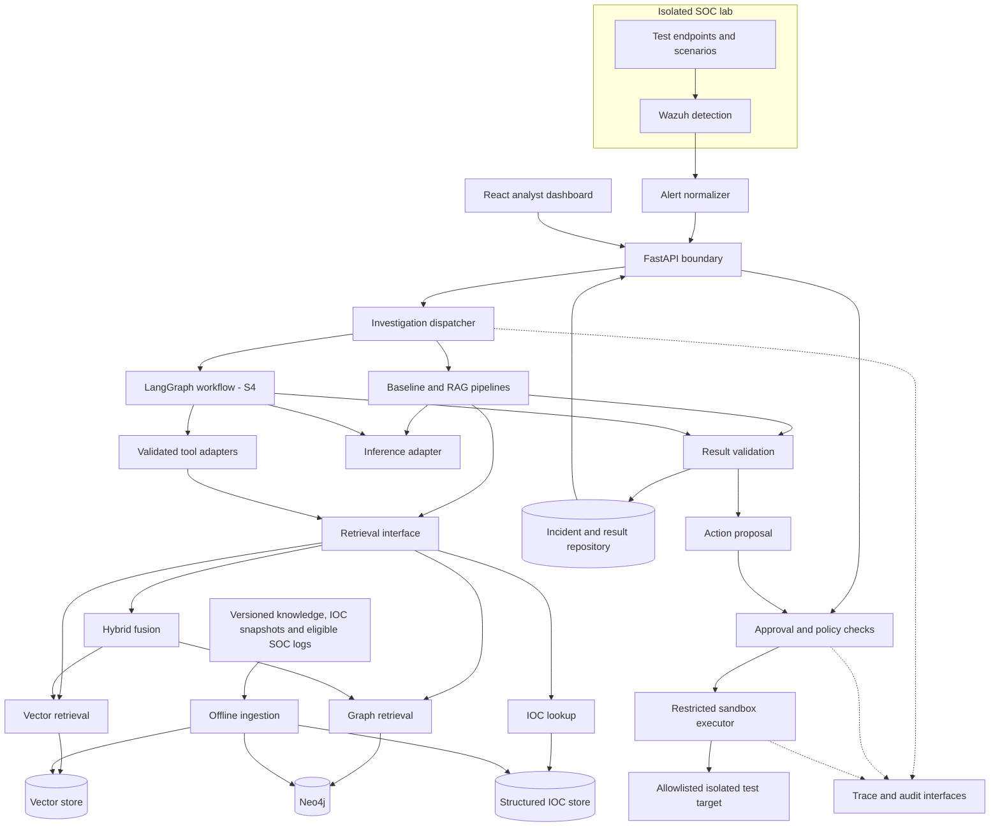
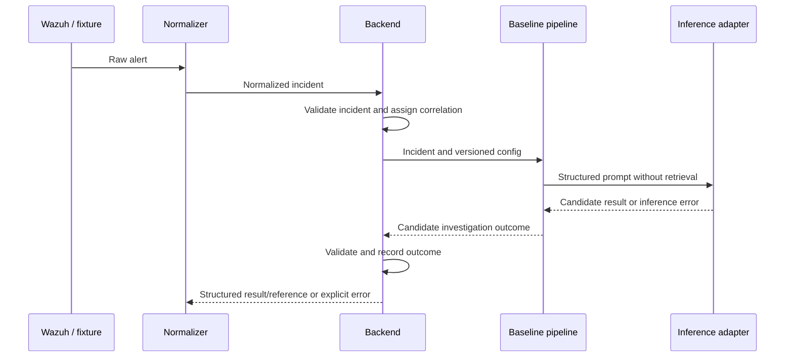
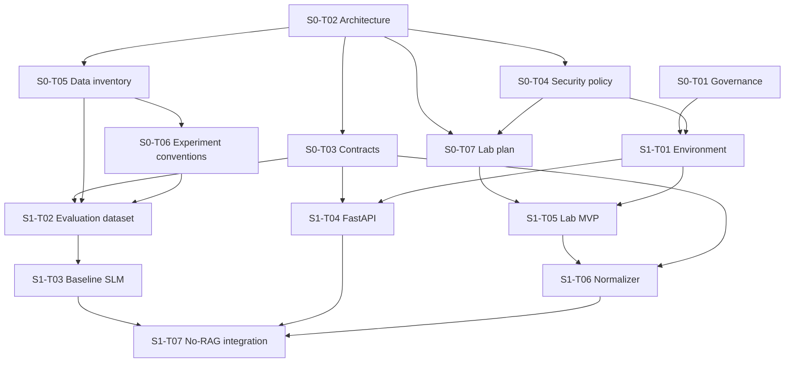

# S0-T02 — Architecture and component boundaries

Status: **Locally verified by Soulaiman; pending assigned-reviewer review and PR workflow. Not implemented.**  
Author: Soulaiman · Assigned reviewer: Anas · Draft date: 2026-10-12

Source of truth: [CDC v2.2](../CDC.md), especially §§3–8, 17, 18 and 23. This document elaborates the CDC without changing its scope. Proposals below require review before being treated as team decisions.

## 1. Purpose and scope

Define the components, their responsibilities, their connections and the dependency path so that contracts, security policy, data preparation and lab planning can proceed consistently.

S0-T02 supplies three deliverables:

| Deliverable | Evidence in this draft |
|---|---|
| Component diagram and service boundaries | Sections 2–4 |
| Ownership-independent interfaces | Sections 5–7 |
| Critical path | Section 8 |

Detailed schemas belong to Oussama's S0-T03; detailed security policy belongs to Achraf's S0-T04; source/model inventory belongs to S0-T05; experiment conventions belong to S0-T06; lab topology and scenarios belong to S0-T07. This document defines their architectural handoffs, not their completed deliverables.

## 2. Architectural approach

**Proposal: begin with a modular Python application exposed by FastAPI.** Inference, retrieval and orchestration have separate interfaces and repository modules, but do not each require a separate network service. This keeps the first end-to-end baseline small while allowing later adapters to use a separately hosted model or database.

Separate runtime boundaries are the SOC lab, the application, external data stores/model serving when needed, the browser, and the response executor. Module boundaries must remain explicit even when several modules run in one process.

The CDC already specifies FastAPI, React/TypeScript, Neo4j and LangGraph. Exact model selection, vector database, artifact storage and serving strategy follow their scheduled ADRs. A monorepo folder is not automatically a Docker service.

### Deployment responsibilities

| Runtime boundary | Responsibility | Initial expectation |
|---|---|---|
| SOC lab | Generate reproducible events and detect them with Wazuh | Isolated lab; detailed topology in S0-T07 |
| Normalizer | Convert Wazuh records into incident objects | Proposed Python adapter under backend; fixture/CLI ingestion first, automated transport decided with S1-T06 |
| Application | API, investigation dispatch, validation, result handling | One FastAPI application with Python modules |
| Model runtime | Execute model inference behind a stable adapter | Local baseline where hardware permits; cloud experiment jobs use the same contract and recorded configuration |
| Retrieval stores | Vector search, Neo4j and structured IOC lookup | Introduced in S2/S3; selected stores use their own database clients |
| Analyst browser | Display incidents, evidence and approval controls | React client in S6; API clients used beforehand |
| Response executor | Execute allowlisted actions on isolated targets | Separate restricted execution boundary in S4; application/model cannot execute arbitrary host commands |
| Experiment jobs | Reproducible evaluation using the same inference/retrieval components | CLI or scripts; no running UI required |

Docker/Compose details and Python/Node versions are S1-T01 work. Cloud GPU notebooks are compute environments, not the authoritative application workspace or a required always-on backend dependency.

## 3. Component map

Arrows denote calls or data flow, not independent services. The backend returns results to its API clients. The dispatcher selects a configured investigation mode; it does not run every pipeline for every request. No-RAG skips retrieval. Agent orchestration is introduced only after the underlying components work independently.

## 4. Module responsibilities

| Repository area | Owns | Boundary |
|---|---|---|
| `backend/` | API validation, incident/result access, investigation dispatch, approval state and audit coordination; proposed normalizer adapter | Delegates inference and retrieval; does not embed model-specific loading or execute sandbox commands itself |
| `ai/` | Model adapter, prompt construction and generation output | Returns data for validation; has no authority to approve or execute actions |
| `rag/` | Knowledge normalization, chunking, embeddings, vector retrieval and hybrid evidence fusion | Produces evidence packages with source provenance; excludes frozen test incidents from retrieval |
| `knowledge-graph/` | Graph schema, graph ETL and bounded graph queries | Exposes evidence through the retrieval interface; graph credentials stay server-side |
| `agents/` | LangGraph state, routing, agent steps and tool adapters | Calls existing validated interfaces; preserves approval and execution separation |
| `security/` | Reusable policy and validation mechanisms | Enforcement happens at API, retrieval/tool, approval and execution boundaries, not only in prompts |
| `datasets/` | Small fixtures, evaluation definitions and version references | Large or sensitive raw data and model weights stay outside Git |
| `experiments/` | Reproducible runners, configurations and result metadata | Reuses application components and frozen evaluation rules |
| `infrastructure/` | Lab, deployment, executor environment and CI | Lab detection and isolated execution remain distinct responsibilities |
| `frontend/` | Analyst interaction through the backend API | No direct model/database credentials or direct executor access |
| `tests/` | Contract, component and end-to-end verification | Tests staged according to the components introduced |

The investigation pipeline coordinates retrieval and inference: `rag/` prepares evidence, and `ai/` constructs model input from the incident and optional evidence and generates candidate output. The backend dispatches the configured pipeline and validates its result. LangGraph later orchestrates these same interfaces.

Ownership-independent means interfaces belong to components and versioned contracts. A change of team member does not change the interface. The hyphenated `knowledge-graph/` directory is a repository area; a valid Python package/import layout will be selected during implementation.

## 5. Interface map

Operation names below are conceptual, not committed endpoint paths or Python signatures. S0-T03 must formalize data types, required fields, versions and error objects before dependent implementations are integrated.

| Producer → consumer | Transport proposal | Input → output | Validation and failure responsibility |
|---|---|---|---|
| Wazuh export → normalizer | Local JSON fixtures first; live ingestion adapter later | Raw alert → CDC §6.1 incident | Normalizer rejects malformed/unsupported alerts; preserves source reference without exposing sensitive raw data |
| Normalizer/client → backend | HTTP JSON; direct fixture runner permitted in tests | Incident → receipt/reference or validation error | Backend validates schema and identity; duplicate handling must be specified in S0-T03 |
| Backend → investigation pipeline | Python interface | Incident + selected mode/config → CDC §6.3 result | Dispatcher enforces allowed modes; records failure and correlation identifiers |
| Pipeline/agent → retriever | Python interface | CDC §6.2 query, limits, filters → evidence | Retriever validates filters/limits; distinguishes an empty result from dependency failure |
| Retriever → vector/graph/IOC store | Store-specific client | Bounded search/query → source records | Adapter handles timeout/unavailability; caller receives a structured failure |
| Pipeline/agent → inference adapter | Python interface initially; optional HTTP adapter later | Incident, prompt/config and optional evidence → candidate structured output | Adapter bounds generation and reports runtime failure; result validator rejects invalid output |
| Workflow → tool adapter | Typed Python call | Validated tool arguments → evidence or structured error | Tool adapter checks allowlists and bounds; model-generated arguments are untrusted |
| Pipeline → result repository | Repository interface; storage implementation pending | Validated investigation result → stored reference | Backend prevents malformed results being reported as successful investigations |
| Analyst → approval service | Backend HTTP API | Action reference + authenticated decision → recorded state | Backend binds approval to the exact action and target; identity policy specified in S0-T04/S4-T05 |
| Approval service → executor | Restricted service boundary; transport chosen before S4-T06 | Validated approved action → execution outcome | Executor rechecks action, target and approval; rejects unauthorized or changed proposals |
| Components → trace/audit sink | Shared recording interface | Correlated events → durable record/reference | Recording failures are explicit; execution must not proceed if its required approval/audit evidence cannot be recorded |
| UI → backend | HTTP JSON, typed client from OpenAPI in S6 | List/detail/investigate/approve/history requests → validated views | API owns authorization, validation and error semantics |
| Evaluation runner → core interfaces | Python calls or API integration tests | Versioned cases/config → predictions, metrics and metadata | Runner records failed cases and configuration; failed runs are not silently omitted |

### Contract handoff to S0-T03

Use the five CDC contracts: incident, retrieval request/response, investigation result, response action and agent trace. Resolve these gaps in their detailed schemas:

- Incident IDs, source IDs, timestamps, duplicate/replay handling and raw-event references.
- Evidence identifiers, provenance, document/snapshot versions and citation references. Scores from vector and graph retrieval need an explicit fusion policy; they are not inherently comparable.
- Investigation mode, outcome/error status and correlation IDs. Preserve the distinction between source alert severity and AI-assessed risk.
- Triage verdict and evaluation fields: the CDC requires true/false-positive, severity, MITRE and action evaluation, but the §6.3 example alone does not define all those fields.
- Action lifecycle and immutable approval binding, execution outcome and retry/idempotency semantics. The model's `requires_approval` output cannot override server policy.
- Trace schema for both non-agent baseline runs and later agent trajectories. Do not label an S1 pipeline as an agent merely to fit the §6.5 example.

Durable incident/result storage technology is an open implementation decision for the backend. Approval and execution audit storage must meet S4-T05's append-only requirement before execution is introduced. The vector store and Neo4j are retrieval stores, not implicitly the authoritative approval ledger.

## 6. Staged end-to-end flows

### S1: first No-RAG baseline

This is a conceptual synchronous baseline proposal. API completion/timeout semantics are finalized in S0-T03 and S1-T04. It requires neither LangGraph nor a vector database nor the React dashboard. Model loading and execution failures must remain visible. Any returned recommendation is data only; S1 has no response execution path.

### S2/S3: evidence-grounded investigation

Offline ingestion versions and normalizes MITRE ATT&CK, CVE/CWE, licensed threat-intelligence snapshots and eligible historical SOC logs. Online retrieval selects Vector, Graph or Hybrid mode, retrieves bounded evidence, builds the model context and validates the result. Empty evidence is recorded explicitly; unavailable retrieval is not silently relabelled as a successful RAG run. A deliberately selected No-RAG comparison remains a separate mode.

The model should cite evidence references that can be resolved back to source records. Frozen test incidents must not enter retrieval collections or fine-tuning data. Split and version rules are defined in S0-T06/S1-T02.

### S4 onward: agentic investigation and approved execution

LangGraph orchestrates the working model and retrieval interfaces. The single-agent baseline comes first; the target multi-agent workflow contains Triage, Investigation, RAG, Knowledge Graph, Threat Intelligence and Response roles. Detailed routing belongs to ADR-004 in S4. A reduced topology is a declared fallback, not the default architecture.

The workflow produces a validated investigation and proposed action. The backend records an analyst's approval against the exact action. The executor verifies approval and policy, acts only on an allowlisted sandbox target, and records the outcome. Rejection stops execution. If an action or target changes, it needs a new approval. An unknown execution outcome must be reconciled before retrying to avoid duplicate side effects.

## 7. Trust, failure and observability boundaries

- Wazuh owns detection; the assistant owns triage, investigation and recommendations. Supervisor scope interpretation is recorded in ADR-009.
- Logs, retrieved documents, threat-intelligence records and model output are untrusted data. They cannot authorize tools or change security policy.
- UI clients and model runtimes receive no direct sandbox-execution or database-administration capability. Secrets are supplied through deployment configuration, with concrete handling rules in S0-T04.
- Retrieval tools are read-oriented and bounded. Response tools are a separate controlled path. The eventual Response agent proposes actions; backend policy and the executor enforce authorization.
- Dependency errors, empty evidence, invalid model output, rejection and execution failure are different outcomes. No component should manufacture a successful result when a required dependency fails.
- Use bounded timeouts/retries for read and inference operations; choose actual budgets during implementation. Avoid blind retries of state-changing actions.
- Correlate incident, investigation, trace, proposal, approval and execution records. Record configuration/version references and failures from the first baseline, using S0-T06 conventions; advanced tracing arrives in S5.
- Audit and experiment records require redaction and access rules. Recording metadata does not justify copying secrets or unrestricted raw logs into Git or prompts.

## 8. Dependency and critical path

These are the CDC task dependencies, not a claim that durations have been estimated. The critical integration milestone is S1-T07: its model, API and normalized-alert branches must converge. S0-T02 directly unblocks S0-T03, S0-T04 and S0-T05; lab planning also needs S0-T04.

After the baseline, the capability path is Vector RAG → Graph/Hybrid RAG → validated agent tools and workflows → approval/sandbox integration → optimization and final measurements → analyst UI → final validation and delivery. Some experiment, documentation and regression work overlaps according to CDC §17; this path does not replace the individual task dependency tables.

## 9. Open decisions and handoffs

| Topic | Responsible task / record | What must be resolved |
|---|---|---|
| Module versus service deployment | S0-T02 review; S1-T01 implementation | Accept or revise modular FastAPI proposal and runtime boundaries |
| Schemas and API behavior | S0-T03; S1-T04 | Field types, versions, error/duplicate semantics, operation shapes and completion behavior |
| Security and lab connectivity | S0-T04; S0-T07 | Identity, credentials, trust boundaries, isolation and allowed transport |
| Source and model inventory | S0-T05; ADR-002 in S1 | Data licenses, hardware fit and shortlist; final baseline model choice |
| Experiment tracking | S0-T06; ADR-010 in S0 | Version conventions, metrics, split rules and tracking tool |
| Scope interpretation | Team/supervisor; ADR-009 in S0 | Detection boundary, six-agent target/fallback and required minimal fine-tuning |
| Incident/result persistence | Backend design before S1-T04 integration | Storage implementation and lifecycle; later durable approval/audit requirements |
| Artifact storage | ADR-006 in S1 | Shared storage and version references for larger artifacts |
| Vector database | ADR-001 in S2 | Select store without changing the retrieval contract |
| Graph schema / threat intelligence | ADR-003 in S3; ADR-008 in S2 | Graph relationships and source/snapshot policy |
| Agent topology | ADR-004 in S4 | State, routing, stop conditions and declared fallback if required |
| Executor connection | S4-T05/S4-T06, consistent with S0 policy | Transport, authorization binding, audit durability and duplicate-execution prevention |
| Serving / benchmark environment | ADR-005 and ADR-007 in S5 | Evidence-based serving choice and official measurement environment |

Existing ADR placeholders are not accepted decisions. Future ADR topics do not all need to be settled to complete S0-T02; unresolved architectural boundaries that block contracts or policy do need explicit resolution in review.

## 10. Review and acceptance checklist

- [x] Soulaiman verified the architecture in the local walkthrough on 2026-10-12. Authorized task branch: `2-s0-t02-architecture-and-component-boundaries`; merge into `main` remains with Soulaiman.
- [ ] Anas reviews component responsibilities, service boundaries and staged flows.
- [ ] Interface handoffs identify producers, consumers, transport, contract and failure responsibility.
- [ ] Oussama can derive S0-T03 schemas without guessing which component owns each exchange.
- [ ] Achraf can derive S0-T04/S0-T07 boundaries without granting AI direct execution authority.
- [ ] S0/S1 dependency graph matches CDC task tables; No-RAG remains independently runnable.
- [ ] Open decisions are assigned to the appropriate tasks/ADRs and required S0 decisions are visible.
- [ ] Local Markdown/link and whitespace checks pass; PR CI passes when a PR exists.
- [ ] Soulaiman's S0 journal contains accurate validation evidence and verified Issue/PR links before Done.

Unchecked items remain pending. Local author verification is not evidence of team acceptance, runtime implementation or completed integration tests.
