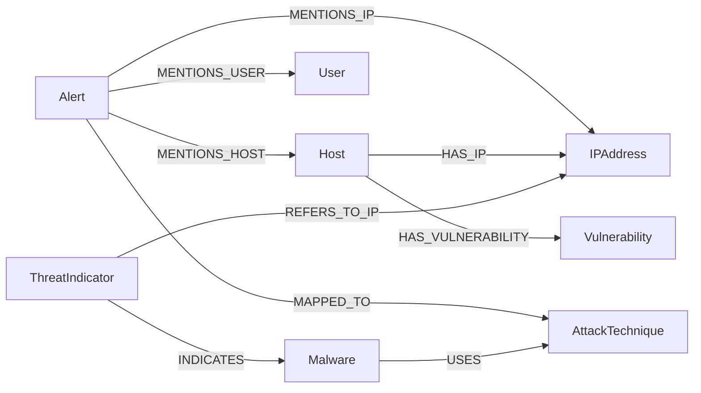

# Knowledge Graph ontology v1 — S3-T01

Status: proposed implementation; user local tests passed; host integrity rerun, CI and Ahmed review pending.
Issue: [#24](https://github.com/CyberSOC-ai/cybersoc-ai/issues/24).
Owner: Achraf. Reviewer: Ahmed. Downstream: Soulaiman, S3-T02.

This contract defines a Neo4j property graph, its offline exchange schema,
deterministic identifiers and provenance. It prepares S3-T02 ETL; it does not
load upstream data, write to Neo4j, serve retrieval or establish incident truth.

## Artifacts

- [Ontology registry](schema/ontology-v1.json): labels, keys, properties and allowed endpoints.
- [Batch schema](schema/graph-batch.schema.json): closed JSON Schema Draft 2020-12.
- [Offline validator](../rag/graph/validate.py): references, identities and semantic rules.
- [Neo4j constraints](schema/constraints.cypher): proposed 5.x node uniqueness constraints.
- [Synthetic batch](examples/minimal-graph.json): all eight business types.
- [Lab mentions](examples/lab-mentions.json): conservative view of the existing incident fixture.
- [Verification guide](validation/VALIDATION.md): commands and pending evidence.
- [Architecture decision](../docs/adr/ADR-003.md).

## Questions supported by this model

Which entities appear in an alert? Which alerts mention one host or scoped IP?
Does a source indicator refer to an observed IP? Which source maps an alert or
malware to an ATT&CK technique? What observation supports a host/CVE association?
Which immutable record version supports each assertion?

## Node dictionary

Every node has `uid`, `label`, `properties`. Business nodes additionally require
a nonempty `source_record_uids` array. SourceRecord is a technical ninth type.
The schema defines exact bounds, enums and formats. No arbitrary properties are accepted.

| Label | Ordered identity fields | Required business properties |
|---|---|---|
| `User` | `scope`, `username` | `username`, `scope` |
| `Host` | `scope`, `name` | `name`, `scope` |
| `IPAddress` | `scope`, `address` | `address`, `scope`, `version` |
| `Alert` | `incident_id` | `incident_id`, `timestamp`, `source`, `source_event_id`, `severity`, `ingestion_kind` |
| `Vulnerability` | `cve_id` | `cve_id` |
| `Malware` | `provider`, `provider_id` | `name`, `provider`, `provider_id` |
| `AttackTechnique` | `attack_domain`, `technique_id` | `technique_id`, `name`, `attack_domain` |
| `ThreatIndicator` | `provider`, `provider_id` | `provider`, `provider_id`, `indicator_type`, `value` |
| `SourceRecord` | `source`, `record_id`, `source_record_id`, `snapshot_ref`, `content_sha256` | `record_id`, `source`, `source_record_id`, `snapshot_ref`, `content_sha256` |

`Alert` is one normalized incident in v1; its identity is `incident_id`.
There is no separate aggregated Incident node. `Host` identities use scoped names
in v1, not invented inventory IDs. A future inventory-based key needs a migration.
Hostnames and user names preserve case; alias resolution is a separately evidenced
ETL operation, never an automatic merge. Use a stable lab/tenant/network/host scope.
If unknown, quarantine for production ETL or use a documented source-local scope;
never use a single global `unknown` scope. Example fixture scopes are local to that run.
IP strings must equal Python ipaddress canonical output; version is 4 or 6.
Private addresses in different networks remain distinct. DNS indicators are lowercase
ASCII labels without a final dot, wildcard, URL or port; hashes are lowercase hex.
ThreatIndicator v1 supports atomic IPv4/IPv6/domain/MD5/SHA1/SHA256 values, not arbitrary
STIX patterns. Provider identifiers are local to the explicitly named provider.
Optional indicator dates and relationship dates are UTC strings ending in Z;
valid_until must not precede valid_from. Missing dates remain absent.

## Relationship dictionary

All relations are directed, many-to-many, with no self loops in v1. Only the
following endpoint pairs are allowed. Presence of provenance is necessary but
does not by itself prove the factual content of an assertion.

| Type | Direction | Creation rule |
|---|---|---|
| `MENTIONS_HOST` | `Alert` → `Host` | Normalized incident entities contain this host. |
| `MENTIONS_USER` | `Alert` → `User` | Normalized incident entities contain this user. |
| `MENTIONS_IP` | `Alert` → `IPAddress` | Normalized incident entities contain this IP. |
| `HAS_IP` | `Host` → `IPAddress` | Explicit inventory or structured observation; never co-occurrence. |
| `HAS_VULNERABILITY` | `Host` → `Vulnerability` | Verified scan/inventory association; not CVE presence in corpus. |
| `MAPPED_TO` | `Alert` → `AttackTechnique` | Explicit source mapping; never inferred from alert text alone. |
| `REFERS_TO_IP` | `ThreatIndicator` → `IPAddress` | Indicator IP version and normalized value equal target IP. |
| `INDICATES` | `ThreatIndicator` → `Malware` | Explicit provider assertion linking the indicator to malware. |
| `USES` | `Malware` → `AttackTechnique` | Explicit upstream relation; both endpoints must resolve. |
| `SUBTECHNIQUE_OF` | `AttackTechnique` → `AttackTechnique` | Explicit ATT&CK hierarchy within one domain. |

Each relation has `uid`, `type`, `from_uid`, `to_uid`, `source_record_uid`,
`properties`. Properties allow only optional `observed_at`, `valid_from`,
`valid_until`. One supporting source record produces one assertion; independent
sources produce parallel assertions. Aggregate/deduplicate evidence at retrieval
time without discarding supporting sources. SourceRecord has no graph relations
in v1: references are explicit UID properties in the exchange format and database.



The arrows represent permitted relations, not assertions about a deployed lab.

## Canonical identity algorithm

Serialize the ordered arrays below with Python json.dumps(ensure_ascii=False,
separators=(",", ":"), allow_nan=False), encode UTF-8, hash SHA-256, prepend `KG-`.
No clock, random UUID, implicit trimming, Unicode normalization or case folding
enters identity. ETL must normalize before calling the helpers.

```text
node:         ["node", label, value_of_key_1, value_of_key_2, ...]
relationship: ["relationship", type, from_uid, to_uid, source_record_uid]
```

Keys use the exact order in the dictionary. Leading/trailing whitespace is rejected.
Changes to display names do not change Malware/AttackTechnique keys; Host/User names
are keys and must not be silently renamed. Relationship properties do not enter the
key: conflicting temporal values for the same source/assertion must be quarantined,
not overwritten silently. Merge nodes on label + uid and relations on type + uid;
union node provenance lists deterministically. Never MERGE on mutable descriptions.
The offline validator accepts self-contained batches: all endpoints and provenance
records must occur in the batch. Incremental partial-reference batches are outside v1.

## Source versions and evidence

SourceRecord preserves source, record_id, source_record_id, snapshot_ref,
content_sha256 from normalized records. record_id alone is not a version key.
SourceRecord UID includes the snapshot and content digest, preserving revisions.
Its source_record_id is limited to 256 characters and snapshot_ref to 1024 to
stay compatible with backend evidence. ETL verifies the actual source bytes and
release manifests; the validator checks digest syntax, not authenticity.

Neo4j properties are scalar values or homogeneous scalar arrays. Do not store a
nested interchange properties object directly: flatten business properties onto
the labeled node/relationship; keep uid and source_record_uids/source_record_uid.
Preserve the original normalized record and full acquisition provenance outside
the graph, resolvable by SourceRecord. SourceRecord fields can be flattened directly.

Nodes represent stable entities; factual associations are versioned assertions.
Optional display names reflect a chosen release. A historical snapshot cannot rely
on mutable node display properties alone: resolve its SourceRecord for that content.
Downstream retrieval must filter assertions and node provenance to an explicit
release allowlist of SourceRecord UIDs; never combine historical/current snapshots
implicitly. The release manifest/selection is an S3-T02 artifact, not a batch default.

For S3-T04, evidence maps source_record_id and snapshot_ref from the supporting
record into the unchanged backend evidence contract. retrieval_method is graph;
scores must declare score_kind (none/null is valid). Native ingestion source `kev`
needs an explicitly documented external mapping (for example threat_intel) while
retaining original CISA provenance. evidence_id is a result-local citation identity,
not necessarily the node UID. Existing backend contracts are unchanged.

## Mapping and downstream handoff

| Existing input | Target / rule |
|---|---|
| Normalized soc_log metadata.incident_id and incident fields | Alert; preserve severity and ingestion_kind |
| soc_log metadata.entities host/user/ip | Scoped nodes and MENTIONS_* only |
| domain/hash/file/process entities | Retain in source; not business nodes in v1; count/document exclusions |
| ATT&CK metadata.technique_id and title | AttackTechnique; explicit domain from source selection |
| ATT&CK relationship metadata source_ref/target_ref | Resolve STIX identities first; allowlisted mapping only |
| STIX subtechnique-of | SUBTECHNIQUE_OF when explicit upstream relation and domain agree |
| STIX malware uses technique | USES only when malware and technique records are both available |
| CVE source_record_id | Vulnerability.cve_id |
| CWE records | Retain in corpus; Weakness node is deferred, not silently mapped to CVE |
| KEV | Supporting source for a CVE; does not establish host vulnerability or an IP IOC |
| S2-T08 provider records | Atomic ThreatIndicator and explicit malware associations, adapter agreement required |
| Sigma/playbooks/public event excerpts | Keep as sources; do not manufacture alert IDs, timestamps or verdicts |

The current ATT&CK adapter supports attack-pattern and relationship, not malware
objects. Define Malware now; S3-T02 must obtain approved source records or extend
the adapter. Unresolved endpoints and unsupported relationship types must be reported
and quarantined/skipped with counts, never silently turned into invented nodes.
The current incident entity contract has no structured source/destination role.
HAS_IP, HAS_VULNERABILITY and MAPPED_TO require additional explicit source evidence.
Lab fixture names linux-01 and linuxsoc remain separate observed identities.

Before producing a production graph batch, S3-T02 must apply existing SOC and
external split policies, hashes, run/group exclusions and duplicate guards. Exclude
held-out test incidents and derived associations together. Never index evaluator
labels or expected actions. A valid batch is not authorization to index its sources.
The lab example is a validation fixture only, not an approved retrieval release.

## Synthetic example

The minimal batch uses documentation IP 192.0.2.10 and invented associations,
including the example host/CVE, malware/technique and indicator links. It provides
no actual threat-intelligence or lab vulnerability evidence. Its synthetic supporting
text is [SYNTHETIC_SOURCE.txt](examples/SYNTHETIC_SOURCE.txt); the stored digest covers
UTF-8 text without the final line-feed. SUBTECHNIQUE_OF is covered by a separate test.

## Validation boundary and next steps

Offline tests cover shape, identity and consistency. They cannot determine whether
an observation is true or a source is licensed/eligible. Neo4j constraint execution,
full ETL, population, Cypher query results and retrieval are pending downstream work.
The user subsequently supplied successful build, Ruff, 86 unit tests and both
example CLI validations; see the verification guide for preserved evidence. The
container integrity command failed because Git is absent from the dev image; a
corrected host command is documented. Integrity rerun, CI, Neo4j checks and Ahmed's
review remain pending. The assistant did not rerun tests.
